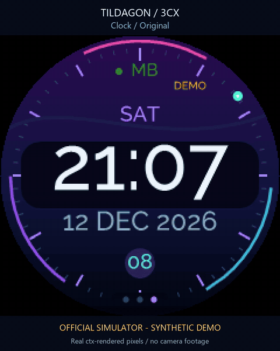
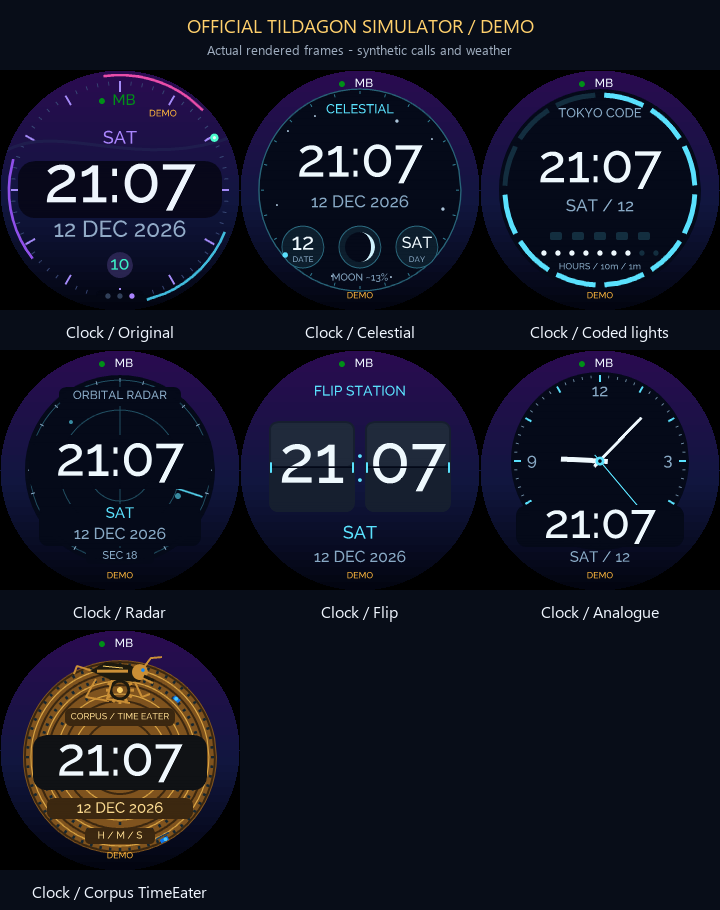
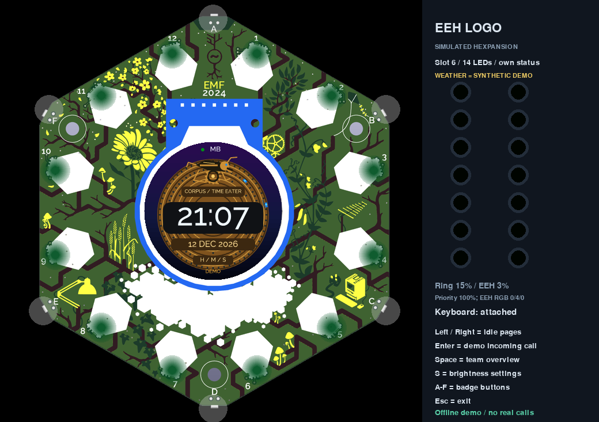
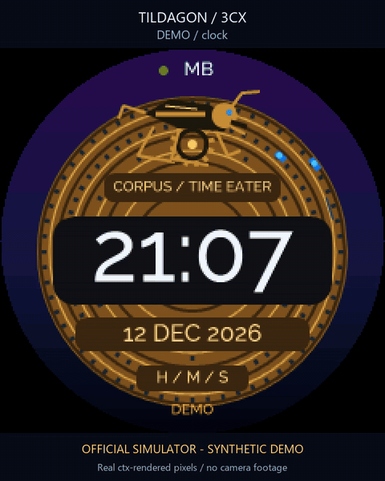
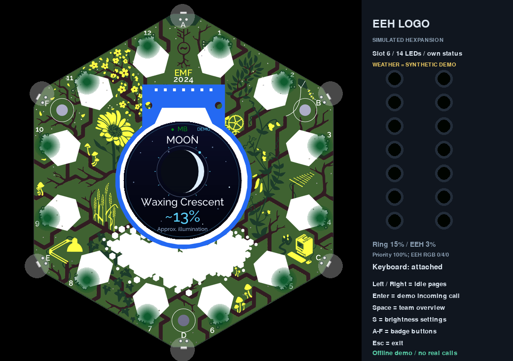
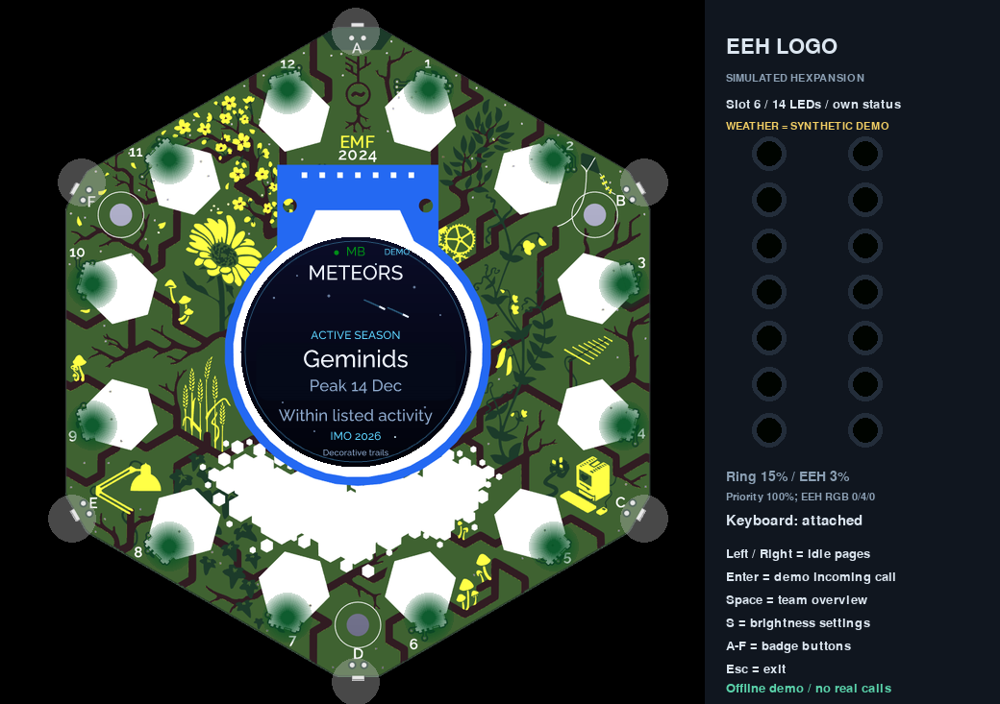
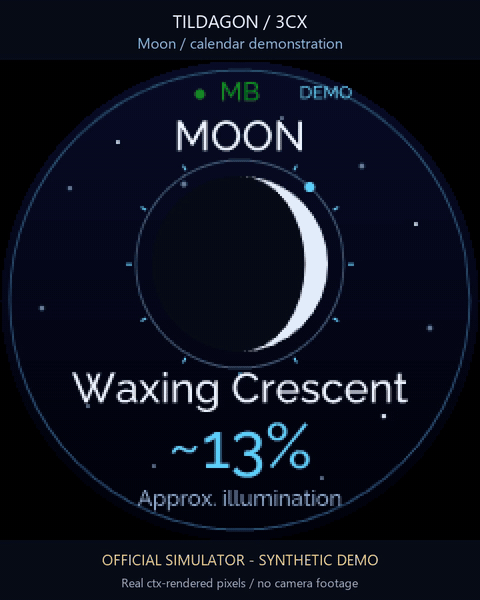

# Clocks and sky

Seven clock styles can be combined with any theme. Press **K**, choose with Left/Right, then Enter. The local clock uses the bridge's time-zone offset; astronomy uses UTC. Invalid time shows an unavailable readout rather than invented positions.

[Play the clock video](docs/gallery/clocks.mp4)

| Clock | What to look for |
|---|---|
| Original | Large digital time, aurora arcs and seconds marker |
| Celestial | A complication-style dial with date, weekday, seconds and computed lunar phase |
| Tokyo Code | Coded light sectors with a clear HH:MM readout |
| Orbital Radar | Scanning orbital instrumentation and a central time display |
| Flip Station | Large split-flap inspired hours and minutes |
| Clean Analogue | A restrained dial with hands and a digital reference |
| Corpus / Time Eater | Brass ripples, three blue light rings and an animated escapement creature |

The Corpus-inspired face borrows the idea of concentric blue light rings, an exposed grasshopper-like time eater and playful uneven movement from the [Corpus Clock described by Cambridge](https://www.cam.ac.uk/news/time-to-unveil-corpus-clock) and [its inventor John C Taylor](https://www.johnctaylor.com/the-chronophage/). The decorative mechanism can hesitate or dart; the badge's readable time stays accurate. It is an original small-screen interpretation.

## Moon and meteor pages

Moon joins weather, rain and clock in the quiet rotation. A meteor page also appears during a catalogued active shower or when a peak is within seven days. It shows calendar activity, not a real-time detection or visibility guarantee. The streaks are decorative. Cloud, moonlight and location affect what you can actually see.

The moon disc uses a northern-hemisphere orientation appropriate for the configured UK location: waxing is lit on the right, waning on the left. Illumination is approximate. Offline phase interpolation uses official USNO quarter-phase anchors for late 2025 through early 2028, then a clearly labelled mean-cycle fallback. The meteor calendar has year-specific 2026/2027 IMO dates; other years say Typical season. [Sources, algorithms and limitations](docs/ASTRONOMY.md).

Own calls, teammate ringing and source failures still interrupt the idle screens. All gallery images and animation use synthetic simulator fixtures; see [media notes](docs/gallery/README.md).
