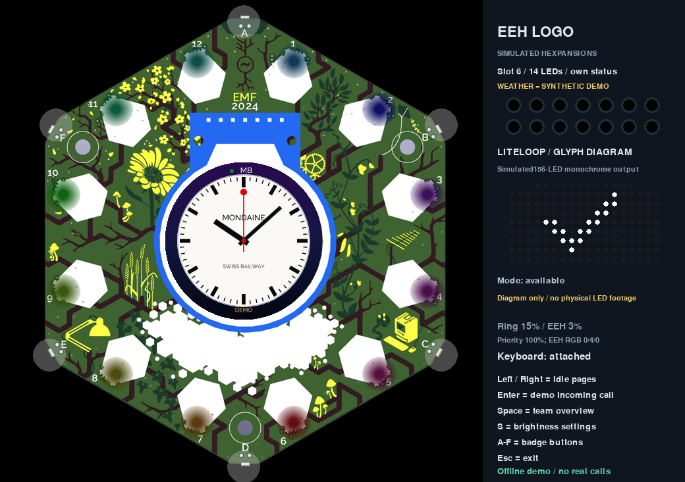
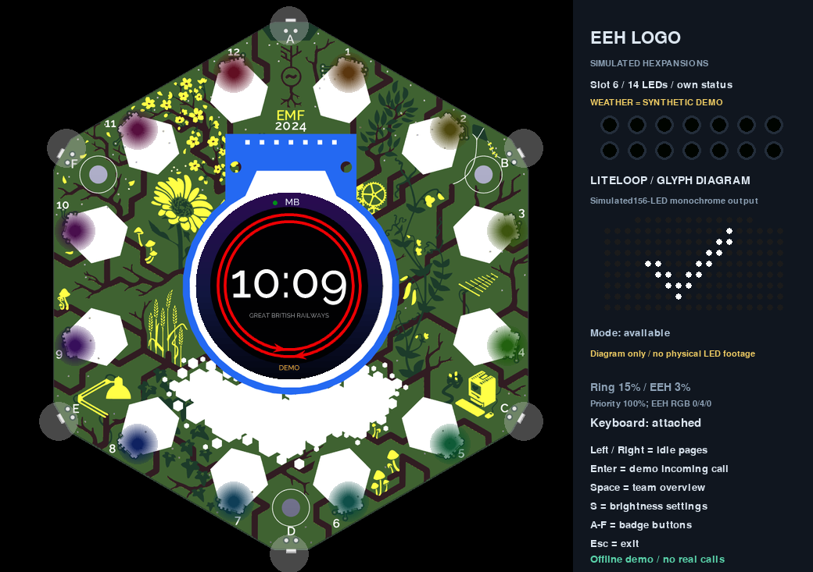
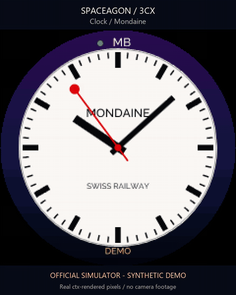
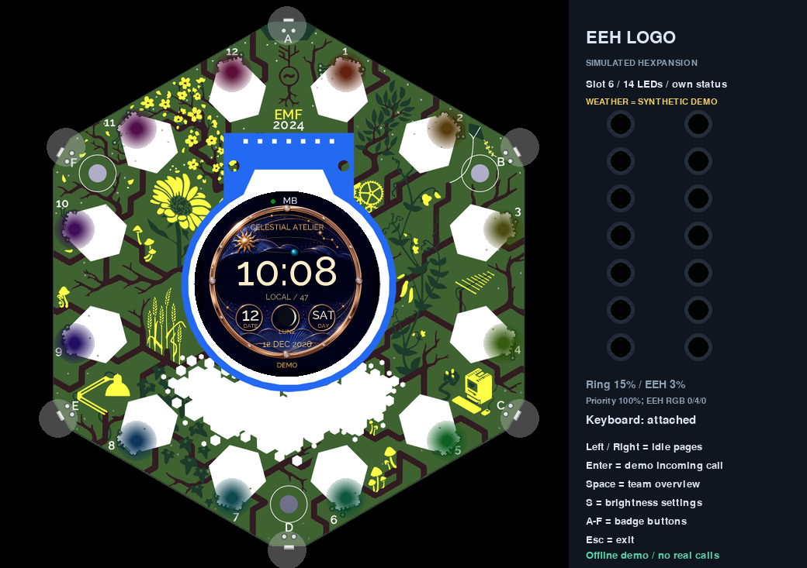
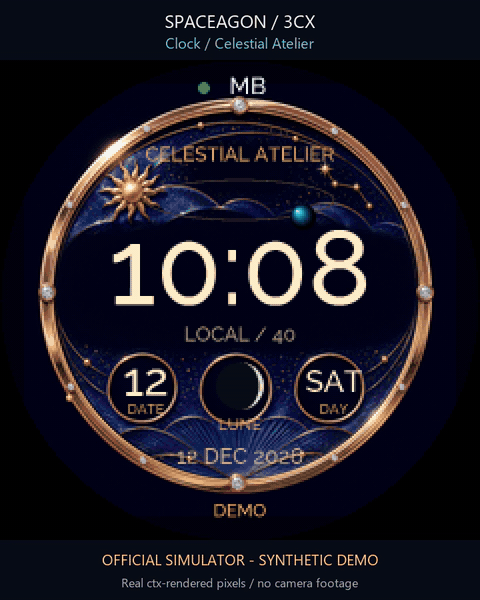

# Clocks and sky

Eleven clock styles can be combined with any theme. Press **K**, choose with Left/Right, then Enter. The local clock uses the bridge's time-zone offset; astronomy uses UTC. Invalid time shows an unavailable readout rather than invented positions.

[Play the clock video](docs/gallery/clocks.mp4)

| Clock | What to look for |
|---|---|
| Original | Large digital time, aurora arcs and seconds marker |
| Celestial | A complication-style dial with date, weekday, seconds and computed lunar phase |
| Tokyo Code | Coded light sectors with a clear HH:MM readout |
| Orbital Radar | Scanning orbital instrumentation and a central time display |
| Flip Station | Large split-flap inspired hours and minutes |
| Clean Analogue | A restrained dial with hands and a digital reference |
| Corpus / Time Eater | Brass ripples, three blue light rings and an animated escapement creature |
| Celestial Atelier | A photographic celestial dial with large native time and a computed moon complication |
| Neon Orrery | Luminous orbital instrumentation, a large digital readout and a computed lunar complication |
| Mondaine | White railway dial, black batons and red lollipop seconds with a two-second pause at twelve |
| Great British Railways | Bold 24-hour digits, twin red perimeter rails and counter-running arrows |

## Mondaine and Great British Railways

[Play the railway clocks video](docs/gallery/clocks-rail.mp4)

The Mondaine-inspired face follows the distinctive
[stop2go movement](https://mondaine.com/pages/stop2go): the red hand completes its
sweep in 58 seconds, rests at twelve for two seconds, and the minute hand then
advances. Its clean analogue dial uses large black hour/minute hands and a red
lollipop tip rather than squeezing in a second digital clock.

The Great British Railways-inspired face follows Network Rail's new
[Rail Clock design](https://www.networkrail.co.uk/wp-content/uploads/2021/06/NRGNCIV30008_Rail_Clock_v1.pdf):
white 24-hour HH:MM on black, surrounded by two red rails. The arrows travel in
opposite directions and meet at the top and bottom every thirty seconds. The
badge uses its built-in font rather than distributing Rail Alphabet Two.

Both are independent native-vector interpretations, with no claim of official
affiliation. They use the supplied local time, including fractional-second motion;
invalid time shows an unavailable readout and does not invent hand positions.
They work with every theme and are included in the continuous demonstration.
Calls and source failures interrupt them through the normal monitor rules.
No additional bitmap, microSD card or network request is needed.

## Celestial Atelier and Neon Orrery

[Play the celestial clock video](docs/gallery/clocks-atelier.mp4)

These are original small-screen interpretations of celestial watchmaking and
neon astronomical instruments, with no brand logos or affiliation.
Visual references include [Van Cleef & Arpels' Poetic Complications](https://www.vancleefarpels.com/us/en/collections/watches/poetic-complications.html) and [Patek Philippe's Celestial](https://www.patek.com/en/collection/grand-complications/6102R-001).
Celestial
Atelier uses a bounded, verified local PNG as dial artwork; its readable time,
moon phase and moving details are drawn by the app. If the artwork is unavailable,
a native vector dial keeps the clock usable. Neon Orrery is drawn entirely with
native vector paths and text.

Time follows the bridge's local clock, and both lunar complications use the same
computed phase as the moon page. Planet positions, orbital motion and other
mechanical details are decorative, not a planetary ephemeris. They do not change
the time or imply astronomical observations. The two faces remain independent of
the selected theme, and phone activity interrupts them before their clock artwork
is drawn.

## Original clock collection

The collection animation above shows the original seven styles. The separate
celestial-pair and railway-pair animations show the four later additions.

The Corpus-inspired face borrows the idea of concentric blue light rings, an exposed grasshopper-like time eater and playful uneven movement from the [Corpus Clock described by Cambridge](https://www.cam.ac.uk/news/time-to-unveil-corpus-clock) and [its inventor John C Taylor](https://www.johnctaylor.com/the-chronophage/). The decorative mechanism can hesitate or dart; the badge's readable time stays accurate. It is an original small-screen interpretation.

## Moon and meteor pages

Moon joins weather, rain and clock in the quiet rotation. A meteor page also appears during a catalogued active shower or when a peak is within seven days. It shows calendar activity, not a real-time detection or visibility guarantee. The streaks are decorative. Cloud, moonlight and location affect what you can actually see.

The moon disc uses a northern-hemisphere orientation appropriate for the configured UK location: waxing is lit on the right, waning on the left. Illumination is approximate. Offline phase interpolation uses official USNO quarter-phase anchors for late 2025 through early 2028, then a clearly labelled mean-cycle fallback. The meteor calendar has year-specific 2026/2027 IMO dates; other years say Typical season. [Sources, algorithms and limitations](docs/ASTRONOMY.md).

Own calls, teammate ringing and source failures still interrupt the idle screens. All gallery images and animation use synthetic simulator fixtures; see [media notes](docs/gallery/README.md).
