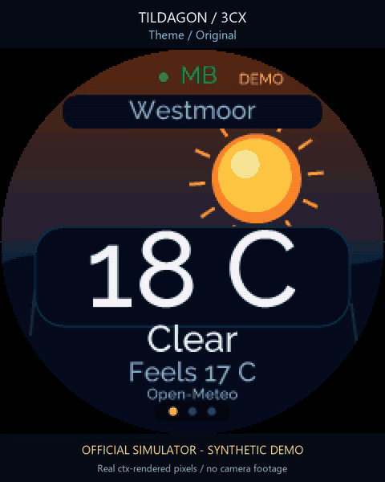
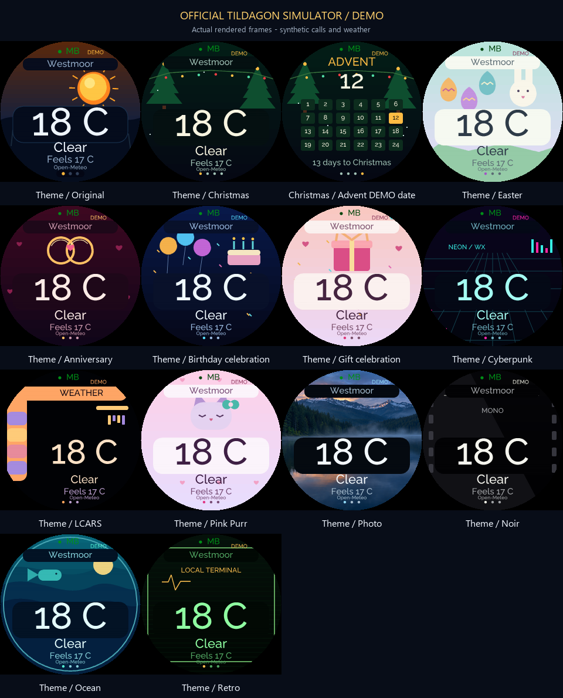
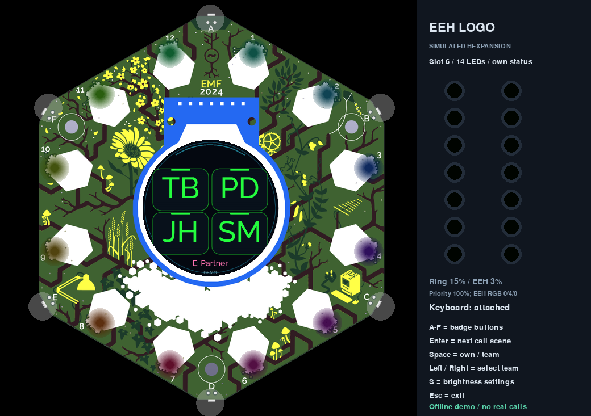
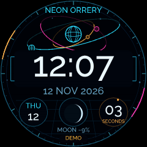
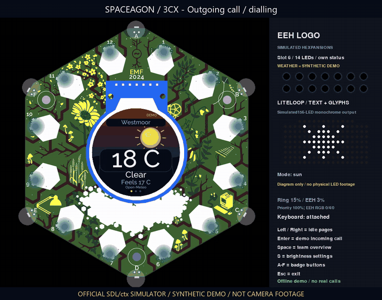
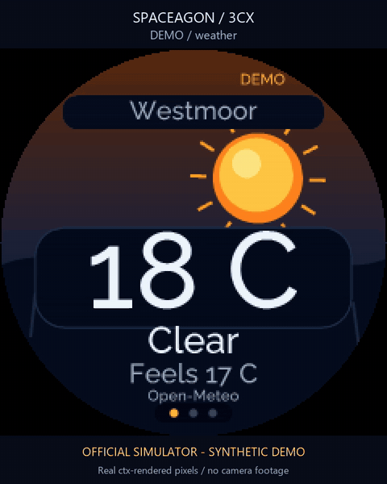
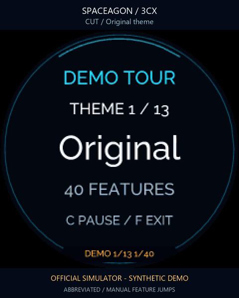
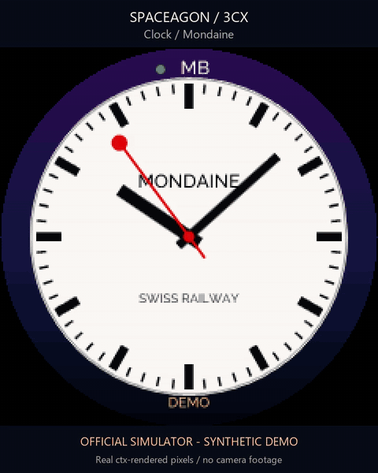
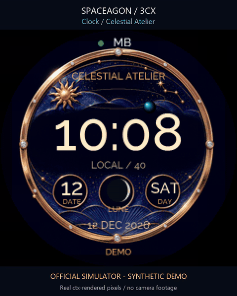
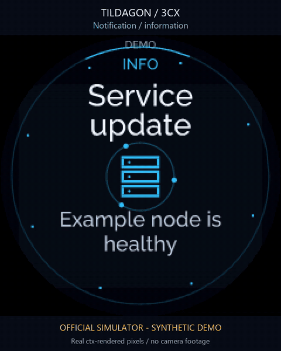

# Spaceagon 3CX Monitor

A full-colour desk companion for a 3CX phone system, built for Spaceagon and compatible Tildagon badges. Four team BLFs surround a readable display; incoming calls take over the screen with caller ID and distinct colours for direct, internal, queue and priority calls.



[Theme gallery and authoring guide](THEMES.md) · [Clock gallery](CLOCKS.md) · [On-device showcase](docs/SHOWCASE.md) · [Setup](docs/SETUP.md) · [Notifications](docs/NOTIFICATIONS.md) · [Spaceagon controls](docs/SPACEAGON.md) · [Astronomy sources and accuracy](docs/ASTRONOMY.md)



## Quiet by default, version0.15.1

Quiet live phone state goes straight to the rotating idle pages. Press Space or
a badge button to reveal the BLF/speed-dial panel; the first press only wakes,
never dials. Any teammate call keeps the panel visible until it ends. A manual
wake lasts60seconds by default. The partner speed dial is shown as **E: Partner**
(your configured name); after waking, badge E or keyboard E selects it.



## Urgent notifications

Priority5 notifications stay visible until dismissed or their original TTL
expires. Only your own priority calls interrupt them, then the card returns.
Normal alerts retain the ten-second popup. [Webhook and Apprise setup](docs/NOTIFICATIONS.md).

## Full-screen clock faces



Neon Orrery, Mondaine and Great British Railways now fill the round display,
with 19% larger dial geometry and no outer theme/status margin. Neon's lower
complications have been rearranged to keep the enlarged readout clear.

## Native matrix text and connected-call timer, version0.15



[Watch the20-second demonstration](docs/gallery/own-calls.mp4) · [Matrix protocol and controls](docs/MATRIX.md)

Ringing callers now use the Lite Loop CH32V006's built-in ASCII text renderer.
The badge loads the name once, then updates its pixel offset instead of sending
whole LED images. Short names stay centred; longer names scroll. The configured
partner keeps the heart while ringing. Dimmed ringing uses static initials
because the manufacturer's native text font is fixed at full brightness.

During any connected or held own call, the matrix alternates the person's name
(their number when unknown) with a compact timer, at full brightness. The LCD
automatically shows outgoing dialling, connected and held calls, including the
other person and elapsed connected time. The theme demo includes outgoing calls.
The timer starts when this badge first observes the connection, includes hold
time and resets for a new call; it cannot recover earlier duration after restart.

## Caller display, version 0.13



[Watch the bunny animation](docs/gallery/bunny-call.mp4). Partner calls show the
configured first name and surname above an animated waving rabbit, without
initials or a phone number. Known callers show their name; unknown callers keep
the complete number. The owner initials and presence dot have been removed
from every screen. BLF colours, own-status pages and expansion status LEDs remain
available. Older gallery films below retain their original version layouts.

The optional private `partner_surname` configuration field supplies the second
name line. Public previews use invented names; personal details stay local.

## What it does

- Live team status and internal peer extension/first name; teammates' external calls show **External**.
- Large own caller ID with wrapping; exact company/personal 3CX contact lookup when enabled.
- Allowlisted speed dials and DND with a keyboard expansion and a separate control token.
- Independent ring and East Essex logo brightness, saved locally; priority calls override those two levels temporarily.
- Thirteen themes, automatic seasonal/personal occasions, December Advent, and eleven interchangeable clocks.
- An on-device **DEMO** showcase covering themes, clocks and features, with isolated synthetic data and no phone commands.
- Weather, next-hour rain, moon phase and animated meteor calendar pages during quiet periods. Call activity interrupts them immediately.
- Rich Apprise/ntfy notification cards with local icons, severity colours and progress updates. Calls take precedence over notification cards.
- Spaceagon joystick and capacitive touch-ring navigation, including notification browsing. These gestures never place calls or change DND.
- A waving bunny for your configured partner, a heartbeat on the East Essex logo and an animated heart on the Liteloop matrix.
- Optional verified PNG asset packs on microSD. Every bundled theme, including the photographic background, fits internal storage.

Badge **0.15.1** / bridge **0.6.0**. The code targets the round 240×240 Spaceagon/Tildagon screen and MicroPython firmware APIs. Gallery images and animations are recordings of the official SDL/ctx simulator running the app with synthetic data. They are not camera footage or hardware frame-rate measurements. Native checks and their version scope are recorded in [validation](docs/VALIDATION.md).

## On-device demo tour

Press **D** on the keyboard, or choose **DEMO** in settings. The badge shows every
feature in each theme before moving to the next: **547 scenes**, all eleven clocks
per theme, and a **45m35s** loop. **C** pauses; **F** exits and resumes monitoring.
Your normal appearance and private configuration return when the tour ends.



[Watch the short preview](docs/gallery/showcase.mp4) · [Controls and full tour](docs/SHOWCASE.md)

## Railway clocks



[Mondaine screenshot](docs/gallery/clock-mondaine.png) · [Great British Railways screenshot](docs/gallery/clock-great_british_railways.png) · [Watch the railway clocks](docs/gallery/clocks-rail.mp4) · [All eleven clocks](CLOCKS.md)

Mondaine has a crisp white dial, black batons and the red lollipop seconds hand,
including its 58-second sweep and two-second stop at twelve. Great British
Railways follows the new Rail Clock: bold 24-hour time on black, with two red
perimeter rails and opposing arrows meeting every thirty seconds. Both are
drawn with native vector geometry and need no SD card or downloaded assets.
Press **K** to choose a clock; both also appear in every theme's demo tour.

## Celestial clocks



[Celestial Atelier screenshot](docs/gallery/clock-haute_celestial.png) · [Neon Orrery screenshot](docs/gallery/clock-neon_orrery.png) · [Watch the MP4](docs/gallery/clocks-atelier.mp4) · [All eleven clocks](CLOCKS.md)

Celestial Atelier combines verified local dial artwork with native time and moon
complications; Neon Orrery uses luminous vector orbital instrumentation. Both are
original interpretations without brand logos. The time and lunar phase are
computed; planetary positions and mechanical motion are decorative. Calls
interrupt both faces immediately.

## Notifications



[Watch the 32-second MP4](docs/gallery/notifications.mp4) · [Notification screenshots](docs/gallery/notifications-contact-sheet.png) · [Configuration and controls](docs/NOTIFICATIONS.md)

The previews use invented messages and reserved example numbers. External senders require a separate `NOTIFY_TOKEN` and an explicitly enabled HTTPS webhook path, or an optional ntfy subscription configured on the bridge. The default example configuration leaves both disabled. Notification payloads cannot execute actions, open links or fetch remote images.

## Controls

With a keyboard expansion: **S** opens settings, **T** opens the theme row, **K** opens the clock row. **Up/Down** selects Ring, EEH, Theme, Clock, Matrix Call or Demo; **Left/Right** changes an appearance value; **Enter** closes appearance settings or starts the selected demo. Physical **A–D** request the four configured team speed dials, **E** requests the partner speed dial, and **F** requests a DND toggle. Settings, notification and showcase views capture those buttons while open.

**N** opens the notification inbox. Arrow keys browse, **Enter/C** dismisses the current item, and **Space/Escape/F** returns. Spaceagon joystick directions and touch-ring rotation also browse; the joystick centre press dismisses an open notification. The [Spaceagon guide](docs/SPACEAGON.md) describes the gestures and their display-only scope.

During idle, keyboard **Left/Right** browses pages and **Space** returns to monitoring. Outside settings, keyboard **Up/Down** adjusts EEH brightness. Without a keyboard, hold **C** for settings; A/D selects a row, B/E changes it, C/F closes it. A short C opens your own status or confirms the current view; F exits the app.

For the [on-device showcase](docs/SHOWCASE.md), press keyboard **D**, or use **S → DEMO → Enter**. Without a keyboard, hold **C** for settings, select **DEMO** and press **C**. In the tour, **B/E** steps through scenes, **A/D** changes theme, **C** pauses and **F** restores your previous view. Keyboard arrows navigate, **Space/Enter** pauses and **Escape/D** returns. Live polling and phone commands are paused while the synthetic tour is active; your normal settings return afterward.

## Architecture

```text
3CX Call Control + own-user session
                  |
             Docker bridge <--- optional Apprise webhook / ntfy stream
                  |
        state bearer / control bearer
                  | verified HTTPS
           Spaceagon / Tildagon
         LCD + ring + EEH + Liteloop
```

The badge stores bridge access tokens; the PBX application key and optional own-user grant stay on the bridge. State reads may reuse one verified TLS connection. Control requests are single-use and never automatically replayed after an uncertain response. The bridge permits only the configured own extension and speed-dial targets. There is no arbitrary dial field or audio transport. A separate notification bearer can submit display messages without reading call data or invoking phone controls.

Start with [setup](docs/SETUP.md), copy the example configuration locally and keep populated credentials, personal dates and contacts out of Git. Weather uses Open-Meteo; astronomy runs offline from the cited USNO/IMO data. No caller-number guessing service is contacted.

## Development

```sh
python -m venv .venv
python -m pip install -r requirements-dev.txt
python tools/run_tests.py
python -m compileall -q badge bridge
```

The [media notes](docs/gallery/README.md) explain how screenshots and animations were captured. [Artwork provenance](artwork/README.md) includes the photographic background's generation prompt. MIT licence; independent visual homages and original art, with no affiliation to the referenced watch or character brands.

## Automatic clock recovery

After Wi-Fi connects, the app synchronizes the UTC clock using the firmware NTP client. Failed attempts retry once a minute; an already valid clock lets monitoring continue. An unset clock keeps verified HTTPS paused until time sync succeeds. The network must permit NTP (UDP port 123). TLS certificate and hostname verification remain enabled.
