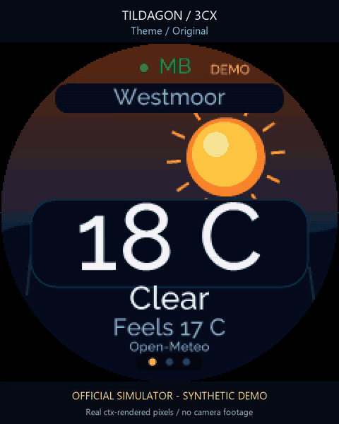
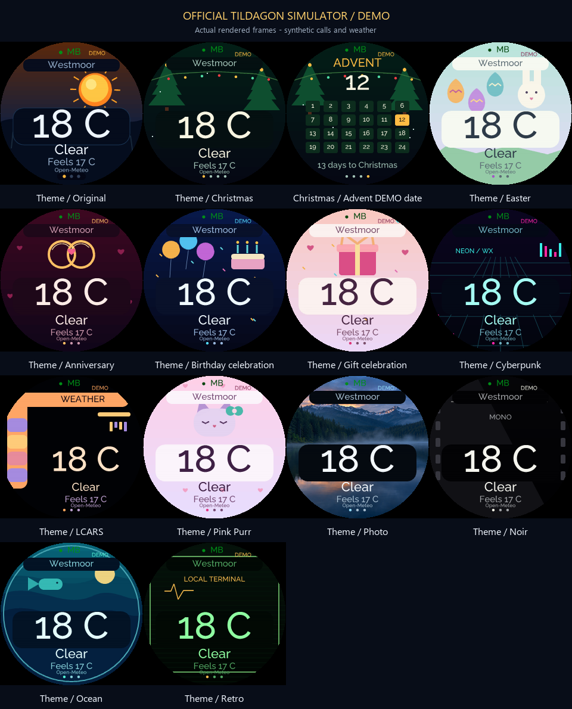
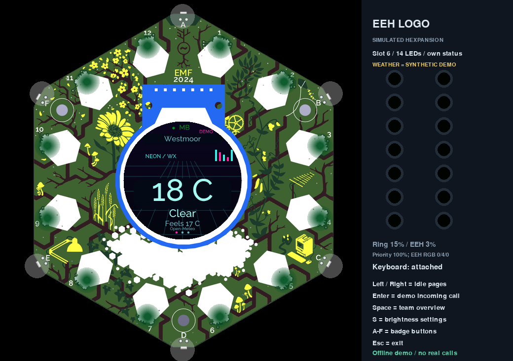
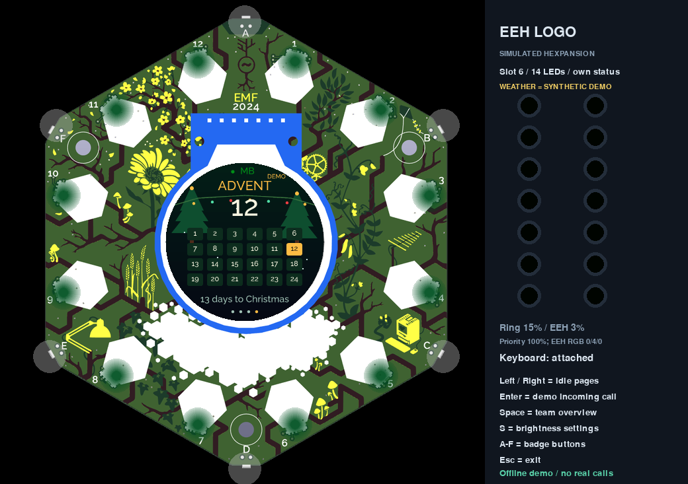
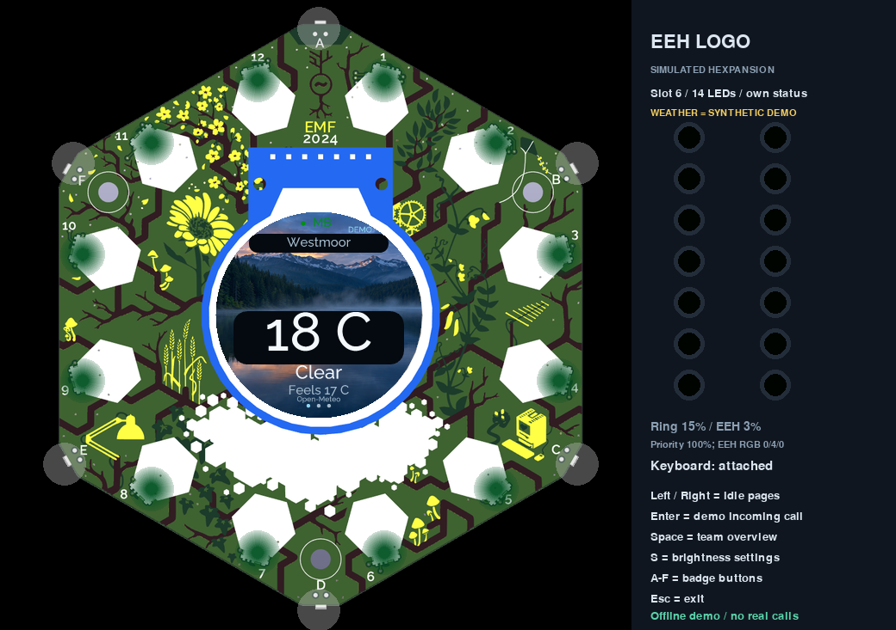

# Theme system

The original animated sky is now **Original**, one of thirteen selectable themes. Choose a visual style independently of your clock. Themes change artwork and palette; call handling, caller-ID fit, freshness checks and controls keep the same behaviour.



[Play the full theme video](docs/gallery/themes.mp4)

## Gallery



| Theme | Design |
|---|---|
| Original | Layered skies, aurora, landscape, rain and snow from the original visual edition |
| Christmas | Fir tree, falling snow and festive lights, with an Advent page in December |
| Easter | Decorated eggs and an original bunny illustration |
| Anniversary | Interlocking rings and floating hearts |
| My birthday | Candles, cake and balloons |
| Partner birthday | Wrapped gifts and a celebration palette |
| Cyberpunk | Neon city instruments, grids and electric accents |
| LCARS | Rounded instrument panels and a warm science-fiction palette |
| Cute cat | Original pastel cat and bow artwork inspired by the cute stationery aesthetic |
| Photo | A photographic alpine lake background with readable panels |
| Noir | Monochrome cinema styling |
| Ocean | Porthole instruments and animated waves |
| Retro | Green CRT scan lines and segmented readouts |





## Choosing and scheduling

Press **T** on the keyboard, or open settings and select **Theme**. Left/Right cycles **Auto** and the theme names. Enter closes settings and previews the result when no call or stale PBX state blocks idle. The firmware saves the selection locally, separately from brightness and the clock selection. Manual themes work year-round.

**Auto** uses local calendar dates from the bridge's time-zone-aware weather snapshot. Priority is your birthday, partner birthday, anniversary, Christmas (1–26 December), then Easter (Good Friday through Easter Monday). Otherwise it uses Original. Invalid/missing time falls back to Original. Personal dates belong only in private `badge/config.json`:

```json
{
  "theme": "original",
  "theme_auto": true,
  "clock_style": "celestial",
  "personal_dates": {
    "birthday_self": "1990-02-03",
    "birthday_partner": "1991-06-07",
    "anniversary": "2020-09-10"
  },
  "theme_leap_day": "feb28",
  "theme_advent_enabled": true
}
```

These are invented examples. Counts appear on the matching occasion only; future dates do not produce negative ages or anniversary counts. February 29 defaults to February 28 in other years, or set `theme_leap_day` to `mar1`.

During 1–24 December, Christmas adds a 24-door Advent screen to the rotation and highlights the current day. Outside that period the page disappears safely. Calls always interrupt it. The sun-rise/set and team-summary pages are absent.

## A special caller

Set private `partner_name` and up to eight exact `partner_numbers` in badge configuration. UK national, +44 and 0044 formatting are normalised; partial numbers and display-name guesses cannot trigger the effect. An incoming match gets rose hearts around the full caller ID. Matching active own calls also drive the expansion effects; stale state clears the celebration.

The **East Essex Logo** has 14 LEDs arranged in an H, so it pulses a red heartbeat across that physical shape. The **Liteloop** matrix renders a real pulsing heart, along with call-type, status, weather and rain glyphs. It is auto-detected only from its exact header, or configured explicitly:

```json
{"matrix": {"type": "Liteloop", "slot": 2, "brightness": 0.15}}
```

Matrix writes yield between bounded register updates and stop on removal, ownership changes or errors. A running manufacturer matrix app takes precedence. The matrix co-processor can retain its last frame when this app exits; power cycling or its own app replaces it. Matrix brightness is independent and defaults to 15%; the existing priority override applies to the badge ring and EEH logo.

## Storage and downloading packs

Vector themes need no SD card. The bundled 240×240 RGB photographic PNG is about 74 KB, so Photo also works in internal flash. The original full-resolution artwork stays in the repository and is never loaded on the badge.

The asset loader checks the application `assets` directory, explicit `theme_asset_roots`, and known SD folders including `/sdcard_1/threecx-themes`. The Dual microSD expansion's first mounted card is supported; mounting is handled by its companion driver. This app never formats or mounts a card itself.

On a computer or Docker host with an SD card mounted, download a pack directly from this public GitHub repository:

```sh
python tools/install_theme_pack.py --target /path/to/mounted/card/threecx-themes --ref main
```

Use a tag or commit ref to pin a version. The installer uses verified HTTPS to the fixed repository, checks bounded catalog metadata, exact size, SHA-256, PNG structure/CRC and bounded decoded dimensions, then stages a directory swap with a reversible backup. It refuses unrelated nonempty directories. GitHub-hosted assets are supported now; a Docker-hosted asset endpoint is not required or enabled. Downloads run on the host, rather than fetching in the badge's rendering loop.

## Creating a theme

`badge/themes.py` owns the catalog/calendar rules. `badge/theme_art.py` owns vector scenery and palette; Original remains in `idle_faces.py`/`idle_art.py`. `clocks.py` draws independent clock content. `astro_faces.py` owns the dedicated moon/meteor scenes.

The vector renderer receives only resolved occasion metadata, weather, freshness, local time and animation time; raw personal dates are not handed to it. Use native ctx paths, opaque fills, cached geometry and small bounded loops. Return False without drawing for an unsupported theme. Avoid `ctx.texture`: the tested firmware binding has an arity defect. Verified local photos use native `ctx.image`.

For an additional data-only photo theme, add a unique safe ID and entry to `badge/assets/catalog.json`, using the existing Photo entry as a template. PNGs must be non-interlaced, 8-bit, at most 240×240 and 128 KiB, with exact size and SHA-256. At most 16 assets are accepted. Extra catalog photos appear in settings and use the Photo panel renderer. Paths cannot escape the pack directory. A missing/invalid asset falls back to the original or readable unavailable display.

## Credits and evidence

Gallery media are actual official-simulator app renders with invented calls and dates. Animations decorate the data and never claim to be live meteor observations. Cute Cat is original artwork, rather than an imported Hello Kitty image. LCARS and other style names describe an independent visual homage. The photographic asset's source, prompt and processing are recorded in [artwork](artwork/README.md). See [clock guide](CLOCKS.md), [astronomy](docs/ASTRONOMY.md) and [validation](docs/VALIDATION.md).
