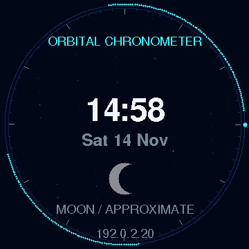
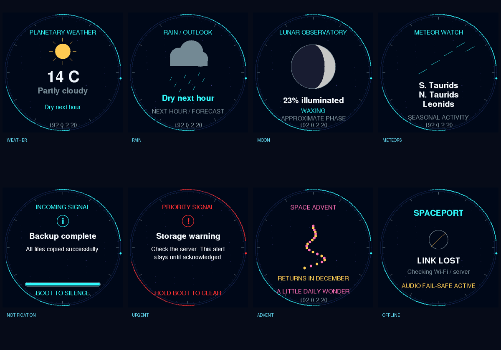

# Spaceport — Spaceagon's audio and display companion

A standalone Wi-Fi companion for the **Waveshare ESP32-S3-LCD-1.85, non-touch**: a 360×360 round colour display, PCM5101 audio DAC, included speaker and physical volume knob. It sits alongside Spaceagon and reads the same protected 3CX bridge. No cable between the two devices is needed.



[Watch the host preview with original ringtone audio](docs/spaceport-tour.mp4). This is generated media, not a recording of the speaker.



**Version 0.2.0.** ESP32-S3 firmware compiles; native logic checks pass. These are **host-rendered previews**, using the production drawing code and font bitmaps with a PC raster shim. They are not camera footage or evidence of physical performance. The ordered board has not arrived: display orientation/colours, expander reset, speaker output, buttons, Wi-Fi reconnection and USB recovery still require hardware validation.

## What it does

- **Spaceagon owns 3CX and clocks:** call screens, BLFs/speed dials, DND, caller animations and clock faces stay on the badge. Set `"device_role": "phone_clock"` in its private `config.json` (also shown in the public example). Missing/other values retain the standalone full-screen notification behaviour.
- **Waveshare owns the dashboard:** weather, next-hour rain outlook, approximate Moon phase, a seasonal meteor activity view and an Advent page from 1–24 December. Clocks and crew/caller screens are excluded from its live rotation. Meteor streaks are decorative; activity windows reuse the [badge's IMO catalogue](../docs/ASTRONOMY.md), not observed rates or visibility predictions. The lunar picture uses a mean 29.530589-day cycle and is approximate.
- Notifications get Waveshare's full screen, including progress and urgency. Urgent notifications remain until local acknowledgement or bridge TTL expiry, including during phone calls. They never cover Spaceagon's clocks or call details in the split role.
- The same notification feed activates Spaceagon's ring LEDs; urgent alerts retain full red ring and slow EEH red breathing. Priority calls override notification lighting. Notification text does not scroll on the badge matrix in the split role; it keeps its phone/clock duties.
- Waveshare still supplies the original call ringtones, including the partner melody. Phone ringing takes audio precedence over notification chimes, while call details remain on Spaceagon. Listen to the [partner chime](data/sounds/partner.wav), [queue ringtone](data/sounds/queue.wav) or [priority ringtone](data/sounds/priority.wav).
- Automatic Wi-Fi reconnection and UK time/DST via NTP. Verified HTTPS waits for a plausible clock. Stale call data stops ringing within five seconds; dashboard freshness is based on the server connection so a disconnected PBX does not hide otherwise available weather/notifications.
- Separate normal/priority audio levels, persistent mute, adjustable display brightness, a silent visual demo and a short test sound. The physical speaker knob still works.

Both devices independently read the existing protected **GET /v1/state** feed. Existing Apprise/ntfy notification integrations need no extra endpoint or direct device-to-device connection. Spaceagon observes the same notification even when Waveshare is offline. Weather is supplied by [Open-Meteo](https://open-meteo.com/), licensed [CC BY 4.0](https://creativecommons.org/licenses/by/4.0/).

**Acknowledgement remains local:** clearing an alert on Waveshare does not clear the shared bridge item or Spaceagon's LEDs; an urgent LED effect ends when that item expires or is updated to a nonurgent state by its sender. No new write token or server route is introduced. Independent polling means transitions may differ briefly.

## Ready for arrival

Download the `spaceport-0.2.0.zip` build artifact or build it below. The factory image contains no Wi-Fi password, bridge token, contact number or personal dates. It includes the eight default WAV sounds. You do not need a microSD card.

1. Unzip into a new folder. Connect **the new Waveshare**, and identify its port by comparing before/after port lists. Do not choose the Spaceagon's port.
2. In PowerShell, inside the unzipped folder:

```powershell
py -m venv .venv
.\.venv\Scripts\python.exe -m pip install -r requirements-install.txt
.\.venv\Scripts\python.exe -m serial.tools.list_ports
.\.venv\Scripts\python.exe flash.py --port COM12 --image spaceport-0.2.0.bin
```

Replace COM12 with the new device. The helper checks the image SHA-256, asks you to identify the target, reads and verifies a **full 16MB factory backup**, then flashes and verifies the new image. Backups may contain factory configuration; keep them private. If USB download mode is required, follow the vendor BOOT/RESET procedure. Do not overwrite an unfamiliar device.

3. Provision locally through USB:

```powershell
.\.venv\Scripts\python.exe provision.py --port COM12 --badge-config "C:\path\to\private\badge\config.json"
```

This reuses the Spaceagon's HTTPS origin, **read token**, CA file and optional partner settings, then asks for the companion's Wi-Fi SSID/password. It does not copy the Spaceagon's control token. The CA path is relative to the private config; use `--ca C:\path\to\ca.der` to override. Alternatively omit `--badge-config` and supply `--ca`; you will be prompted for the HTTPS origin/read token/partner number. Credentials stay in the device's NVS and are never compiled into the public firmware.

The helper creates `spaceport-access.local.json` with a generated local-control password. Keep it private. The idle screen shows the device's IP, also visible in your router. Browse to `http://DEVICE-IP`, username **spaceport**, password from that receipt.

**Local web controls use HTTP Basic authentication and are intended only for your trusted LAN. Do not publish that interface through the internet tunnel.** The outgoing bridge connection uses verified HTTPS. NTP/DNS and outbound HTTPS must be allowed on the Wi-Fi network; the ESP32 uses 2.4GHz Wi-Fi.

## Controls

| Control | Action |
|---|---|
| Speaker volume knob | Physical output level |
| BOOT short press while ringing/alerting | Silence this call/notice on Spaceport |
| BOOT short press while idle | Next idle page |
| Hold BOOT over 1.5 seconds on a notice | Clear that notice locally |
| Hold BOOT over 1.5 seconds otherwise | Start/stop silent visual demo |
| Local web page | Mute/unmute, normal/priority volume, brightness, silence, dismiss, page, demo, test sound |

Use BOOT during normal running, not RESET or the power button. The ordered variant does not require touch. A real urgent notice interrupts the visual demo; priority call ringtones can still sound without replacing the dashboard. The tour exits after two minutes. Global mute also mutes priority calls; unmute explicitly to hear them. Defaults are conservative digital levels (20% normal, 35% priority), independent of the analog knob. Actual acoustic level is unmeasured.

## Build and customise

Python 3.10+ and PlatformIO 6.1.18:

```powershell
py -m venv .build
.\.build\Scripts\python.exe -m pip install platformio==6.1.18
.\.build\Scripts\python.exe tools/build_release.py
```

This builds firmware and LittleFS and produces `release/spaceport-0.2.0.zip`, its merged image and SHA-256 manifest. Dependencies are pinned in `platformio.ini`. Flash layout: two 5MB OTA slots and a 0x5f0000-byte LittleFS partition; no OTA upload endpoint is enabled in this release. Hardware target is 16MB flash/8MB OPI PSRAM. Do not flash the image to a differently sized board.

Default tones are original generated compositions. Regenerate using `python tools/make_sounds.py`. Replace one with your own recording/music using ffmpeg:

```powershell
python tools/convert_sound.py my-recording.mp3 partner
```

The converter caps duration at eight seconds and produces 22,050Hz mono 16-bit PCM WAV. Rebuild the release to include it. The PCM5101 is a DAC, not an MP3 decoder: firmware plays bounded canonical WAV files. If the filesystem is missing it falls back to synthesized tones and never auto-formats storage.

Native logic checks (C++17):

```sh
g++ -std=c++17 -Iinclude tests/engine_test.cpp -o engine-test
./engine-test
g++ -std=c++17 -Iinclude -I.pio/libdeps/spaceport/ArduinoJson/src tests/protocol_test.cpp -o protocol-test
./protocol-test
```

After PlatformIO installs dependencies, `python tools/preview.py` renders the production layout and creates the gallery/GIF (requires Pillow and a C++17 compiler; `--compiler` selects it; add `--video` with imageio-ffmpeg installed for an MP4 with ringtone audio). Host rounded primitives can differ slightly from the hardware library. The source includes a synthetic demo, not a phone-call generator.

## First physical checks

Confirm USB backup/restore, correct panel orientation and colours, readable edge text, smooth animation without watchdog resets, knob and digital volume operation, BOOT actions, and that unplugging Wi-Fi/server stops ringing within five seconds. Test direct/internal/queue/group/priority/partner calls and outgoing connected calls, then persistent urgent notifications and priority-call preemption. Measure comfortable speaker levels before leaving it unattended. Test power cycling and overnight reconnect/NTP before relying on it as a ringer.

Restore the full factory backup using the same port and esptool version:

```powershell
.\.venv\Scripts\python.exe -m esptool --chip esp32s3 --port COM12 write_flash --flash_size 16MB 0 spaceport-factory-backup-TIMESTAMP/factory-16MB.bin
.\.venv\Scripts\python.exe -m esptool --chip esp32s3 --port COM12 verify_flash 0 spaceport-factory-backup-TIMESTAMP/factory-16MB.bin
```

## Board references

[Waveshare board documentation](https://docs.waveshare.com/ESP32-S3-LCD-1.85) and [official Espressif board configuration](https://github.com/esp-arduino-libs/ESP32_Display_Panel/blob/92b790ed6d24b0678e2f45b1fc85f0abd2d41b33/src/board/supported/waveshare/BOARD_WAVESHARE_ESP32_S3_TOUCH_LCD_1_85.h). The shared display configuration also covers the non-touch variant. Touch and microphone are not used. See [NOTICE](NOTICE) for panel initialisation attribution.
