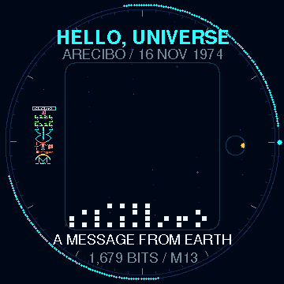

# Hello, Universe

The first new ambient screen is the original 1974 Arecibo message: 1,679 bits,
arranged as 73 rows of 23 pixels. The colours are a modern presentation layer;
the underlying message remains monochrome binary data.

Waveshare adds the screen to its normal idle rotation, with a 30-second dwell so
a complete scroll fits. The viewport preserves all 23 columns. A miniature shows
the complete message and highlights the current section. Calls, notifications
and the away lock retain their existing priority. Short-press BOOT or use Mission
Control's Next screen button to browse to it. The visual demo includes it too.

## Matrix

The matrix Arecibo animation has been removed following physical testing: its
host-streamed bitmap animation was too slow, and sideways panning was unwanted.
Arecibo remains a Waveshare idle screen. The matrix retains call details,
notifications, the Keziah heart, focus sand and away Snake.

The LCD animation above is a host preview of the production rendering code,
not a recording of the physical display.

## Data and validation

- [SETI Institute: Arecibo message](https://www.seti.org/research/seti-101/project-phoenix/arecibo/)
- [University of Oregon: full 73-by-23 transcription](https://pages.uoregon.edu/jimbrau/astr123/Notes/ch28/73by23.html)
- Canonical source: [`assets/arecibo.txt`](../assets/arecibo.txt). Its transcription
  was also compared with the full binary listing on Wikipedia.
- SHA-256 of all 1,679 ASCII bits with no separators:
  `24babf56f872fc2c38c940b4a438811be454f04a041fe56b3c239662f261dd66`.

Tests compare the C++ message with the canonical data and ensure ordinary matrix
idle scenes remain active. The matrix/focus/Arecibo regression checks passed
42 tests after removing the matrix animation. The Waveshare firmware is unchanged.
Installation preserves badge configuration and CA.
