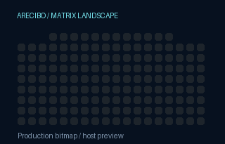

# Hello, Universe

The first new ambient screen is the original 1974 Arecibo message: 1,679 bits,
arranged as 73 rows of 23 pixels. The colours are a modern presentation layer;
the underlying message remains monochrome binary data.


Waveshare adds the screen to its normal idle rotation, with a 30-second dwell so
a complete scroll fits. The viewport preserves all 23 columns. A miniature shows
the complete message and highlights the current section. Calls, notifications
and the away lock retain their existing priority. Short-press BOOT or use Mission
Control's Next screen button to browse to it. The visual demo includes it too.

## Matrix



The matrix uses its native **18-pixel long edge as the width**, regardless of the
badge port. It does not inherit the focus-sand direction or rotate into a narrow
9-pixel-wide layout. The board's physical mounting still determines its angle;
software cannot turn the physical long edge. Its shorter top row stays dark.

The original message is five columns wider than the matrix, so an eight-row
window scrolls vertically while panning gently five pixels sideways. There is no
downsampling, merged data or permanently discarded column. The logical window
covers every original bit. Actual update cadence also depends on badge rendering
and the matrix's I2C transfer time.

It appears during the first 56.7 seconds of each two-minute quiet idle cycle,
then returns to the existing matrix scenes. Calls, team call activity,
notifications, focus mode and away mode take precedence. Away still uses Snake;
Keziah's incoming-call heart is unchanged. Brightness follows Focus Light, with
an additional idle ceiling of 120/255.

The animations above are host previews of the production rendering code, not
photographs or recordings of the physical devices.

## Data and validation

- [SETI Institute: Arecibo message](https://www.seti.org/research/seti-101/project-phoenix/arecibo/)
- [University of Oregon: full 73-by-23 transcription](https://pages.uoregon.edu/jimbrau/astr123/Notes/ch28/73by23.html)
- Canonical source: [`assets/arecibo.txt`](../assets/arecibo.txt). Its transcription
  was also compared with the full binary listing on Wikipedia.
- SHA-256 of all 1,679 ASCII bits with no separators:
  `24babf56f872fc2c38c940b4a438811be454f04a041fe56b3c239662f261dd66`.

Tests compare the Python, C++ and canonical data; check complete matrix viewport
coverage and safe physical LED indices; and check that call data preempts the
animation. The production C++ renderer generated the LCD preview. The full Python
suite passed 816 checks. Installation preserves badge configuration, CA and
Waveshare NVS, including the paired phone and Wi-Fi settings.

To regenerate animations, compile `companion/tests/render_preview.cpp` with the
host raster sink and the pinned GFX fonts, then run:

```powershell
python tools/preview_arecibo.py --renderer path/to/render_preview.exe
```
