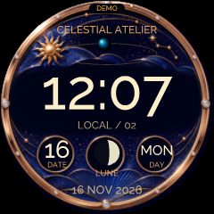

# Away mode and proximity test

Waveshare recognises the paired iPhone over BLE. When enabled and no qualifying signal is seen for 60 seconds, it silences audio, dims its display and shows a minimal AWAY lock screen. A linked Spaceagon hides caller details, uses a gentle two-minute rainbow cycle on ring LEDs (5% by default, respecting their saved brightness ceilings) and shows a static AWAY on the matrix. The EEH logo is off while away. Returning nearby restores the original screens and saved brightness levels. Urgent notifications and priority calls do not override the away presentation.

Spaceagon reads an authenticated, read-only LAN endpoint on Waveshare every three seconds. The private presence token grants no phone controls and is separate from PBX, notification and Waveshare admin credentials. Both devices need LAN connectivity to Waveshare. Missing or stale presence responses lock the badge with PRESENCE OFFLINE after 15 seconds. The local link is not a cloud relay and is not published through the public tunnel. See [pairing and configuration](../companion/docs/PRESENCE.md).

## Test

1. Leave Bluetooth on; lock the iPhone and keep it by the devices. Confirm the normal display and a short test chime.
2. Take the locked phone away from the desk for at least 90 seconds. The displays should show AWAY; ring and EEH LEDs should show the gentle rainbow and the matrix showing AWAY.
3. Send a new notification or make an incoming test call. The away presentation should remain and Waveshare should stay quiet.
4. Bring the phone back. Normal screens and brightness should resume after detection and the next badge poll, usually within several seconds. Trigger a new chime to check audio.

If the next room still counts as nearby, use the Waveshare's local controls to raise the RSSI threshold (e.g. -72 to -62 dBm), then repeat. Bluetooth strength is not a room boundary. Some iPhones advertise intermittently when locked; the system fails quiet. Pairing and a two-minute locked-phone test were previously confirmed; the walk-away range calibration remains a physical check.

## Full-screen clocks

The independent custom dials now use the recovered full circular display area, including Celestial Atelier. This screenshot is a native simulator render using synthetic demo data, not a camera recording:

