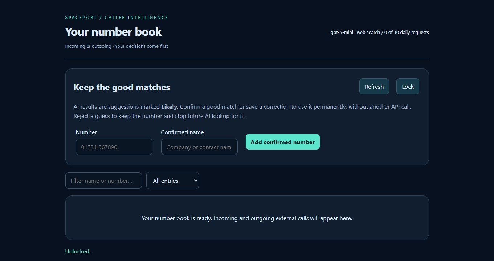

# Caller lookup and your number book

The bridge can identify unknown incoming **and outgoing** external peers on your
own extension using OpenAI Responses web search. It uses `gpt-5-mini`, low
reasoning, a small search context, at most two tool calls and 1,800 output tokens.
It searches only for the number, without sending PBX credentials, call metadata,
the phone book, names or user details. API and web search usage are chargeable.

## Matching order

1. Your confirmed or corrected number-book entries.
2. Configured aliases and 3CX company/personal contacts, then supplied PBX names.
3. An unexpired AI suggestion, shown as **Likely: Company**.
4. The original number when evidence is weak, ambiguous or unavailable.

3CX's targeted contact read gets the first chance before AI runs. Internal
extensions and other team members' external numbers never trigger AI requests.
An AI result must identify a business, quote its entire matching phone number,
and cite a URL present in actual completed search results. These checks reduce
false matches; they do not prove who is calling, and incoming numbers can be
spoofed. No result changes call priority, routing, DND or dial targets.

Lookups run in background tasks. Slow searches never delay a state response,
ringing, controls or the clock. Names appear on a later refresh or a future call.

## Persistent storage

`/data/caller-book.sqlite3` is a SQLite database on the existing named Docker
volume. Confirmed names and corrections do not expire. Rejecting a guess
suppresses further AI lookup for that number until you supply a correction.
Suggestions expire after 30 days; misses are cached for seven days; failures
back off for one hour. Expired suggestions are not displayed as current names.
The review page shows up to 500 recently seen numbers; older records remain in
the database. A review made while a search is running always wins over the result.

The default cap is **10 new lookup requests per UTC day**, including failures.
Usage reservations are durable, so a restart does not reset the allowance.
There is no automatic retry of an uncertain chargeable response. A matching
cache entry, known 3CX contact, correction or confirmation does not use the API.
This is a request cap, not a currency budget: set a project limit in OpenAI too.

## Setup

Set `OPENAI_API_KEY`, a separate random `LOOKUP_ADMIN_TOKEN` (at least 24 ASCII
characters), and optionally `OPENAI_LOOKUP_DAILY_LIMIT` and `OPENAI_LOOKUP_MODEL`.
Both compose examples pass these variables through. The database path is
`CALLER_BOOK_FILE=/data/caller-book.sqlite3`. Keep the existing `/data` volume.
`OPENAI_API_KEY_FILE` is supported instead of the key environment variable for
deployments that mount secrets. The key is never returned by any HTTP endpoint.

Open `/lookup` through your authenticated HTTPS service, enter the review
password, and confirm, correct or reject suggestions. You can add a confirmed
number before ever calling it. The password stays in tab memory and disappears
when you lock/reload. It is independent of badge, phone-control and notification
tokens. APIs require the review bearer plus the custom review header; cross-origin
browser requests receive no CORS permission. Never put the password in a URL.

Allow `/lookup` and `/lookup/*` in the existing reverse proxy/tunnel only when
you want remote review. The public HTML contains no caller data or credentials;
the database API remains authenticated. No arbitrary public number-search route
is provided.

Back up the database using SQLite's backup API, which includes committed WAL
transactions, or stop the container before copying all database files. Do not
delete the named volume when updating the image. Database files and personal
entries must never be committed to source control.

## References

- [OpenAI web search](https://developers.openai.com/api/docs/guides/tools-web-search)
- [GPT-5 mini](https://developers.openai.com/api/docs/models/gpt-5-mini)
- [Current API pricing](https://developers.openai.com/api/docs/pricing)

Validation uses synthetic telephone numbers for automated tests. Live API smoke
tests use public business numbers; a missing name is an acceptable neutral result.
