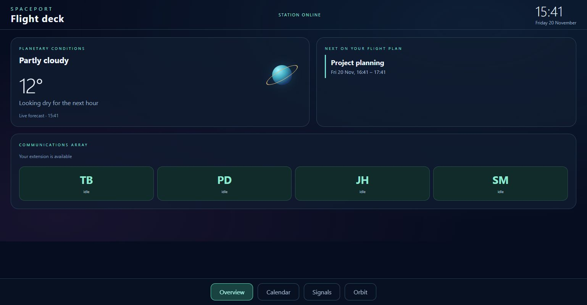

# Fire tablet: Flight deck

Flight deck is a separate, read-only display served by the broker at `/tablet`.
It is not Mission Control and has no PIN or administrator login. It shows weather,
calendar titles and times, team status, focus progress and notifications, with a
quiet orbit page in the rotation. Waveshare firmware 0.10.1 reports iPhone presence to hide details when
away; that firmware must be installed to enable this feature. Waveshare remains responsible for audio.

## Setup

Set an independent random `TABLET_TOKEN` (at least 32 ASCII characters) in the
broker environment. Never reuse a badge, notification or administrator token.
Publish only `/tablet`, `/tablet/` and `/tablet/api/state` through the tunnel.
The HTML shell contains no credentials; the API requires the tablet bearer token.
This capability cannot change settings, report device state or make calls.

On the tablet, provision once using `/tablet#pair=TOKEN` through a private local
setup flow. The page stores the token on that device and immediately removes the
fragment. Keep the Fully start URL as the clean `/tablet` address. Do not share
or screenshot the provisioning URL. Clearing Fully site data requires provisioning
again. Rotate TABLET_TOKEN to revoke the tablet.

Use Fully in fullscreen, preferably landscape, with Kiosk Mode off if no exit PIN
is wanted. This does not remove authentication from the separate `/admin` console.
The display has four touch tabs and rotates pages after inactivity. Dismissing a
notification here affects this display only, not the other devices.
