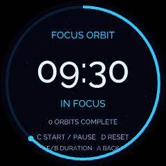
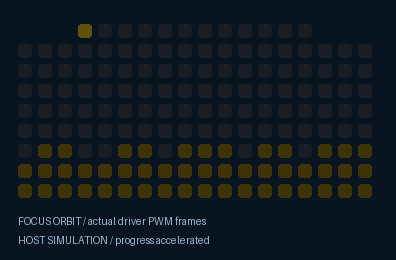

# Focus Orbit

Spaceagon has a monotonic focus timer, an orbital countdown, outer-LED progress,
and a falling-pixel progress bed on the Liteloop matrix.

Open **A → Focus orbit → C**, or press keyboard **P**. On the focus page:

- **C / Enter / Space:** start, pause or resume.
- **F/B / Left/Right:** adjust a stopped timer in five-minute steps (5–90 minutes).
- **D / Backspace:** reset the current timer.
- **A / Escape / P:** close the page; the timer continues behind your clocks.

The default focus interval is 25 minutes. A completed focus interval starts a
five-minute break, or a 15-minute break after every fourth completed interval.
After the break, start the next orbit explicitly. Session state resets on app
restart. DND remains available through its existing explicit menu action.

The matrix uses its configured brightness and the outer LEDs respect their
brightness setting. Slow comet trails fall into a settled progress bed; pausing
freezes the matrix. These are grayscale animations on the matrix's fixed-colour
LEDs, rather than RGB effects.

Own calls and team call activity restore normal BLF/caller/timer output. Alert
lighting and away mode take precedence; the existing away Snake and EEH-off
behaviour remain. Elapsed focus time continues during calls and absence. No
phone call, DND command or notification is sent by the timer.

The GIF accelerates elapsed progress for illustration. Physical matrix writes
use the production adapter's bounded asynchronous PWM path. The hardware has
18×9 display positions and 150 LEDs; unused positions are skipped.
