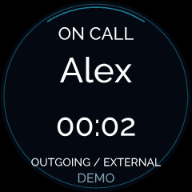

# Lite Loop caller names and timers

## Display behaviour

Incoming names use native ASCII scrolling at full Matrix Call brightness.
Short names are centred without scrolling; long names pause briefly, then move
through the display. Ringing still respects Settings / Matrix Call: dim levels
use static initials through direct PWM, and zero switches the ringing image off.
The partner keeps the animated heart while ringing.

Connected and held calls always use full brightness, as requested. They
alternate the name or unknown caller's number with the same observed elapsed
timer used by the LCD. Short names dwell for five seconds; long names receive
enough time to traverse the18-column display. The timer then stays for five
seconds. New calls restart with the name. A waiting incoming call takes over.

The timer uses four3x5 digits and a narrow colon, fitting17 columns without
scrolling. It displays MM:SS up to99:59, then HH:MM; the LCD retains full H:MM:SS.
Hold time continues to count. Elapsed time begins with the badge's first
observed connection, not dialling; reconnecting or starting the app mid-call
cannot reconstruct an earlier duration. Stale data never shows a live call.

## Native protocol

The manufacturer firmware renders ASCII on the CH32V006. Register0x37 selects
text pattern3; 0x38/0x39 are the big-endian16-bit pixel offset; 0x3A selects
blit32 font1. A NUL-terminated bounded ASCII string occupies0x51 onward, with
direct control0x50 set to0. The renderer hardcodes its text pixels at255.
Only changed offset bytes are sent after a name is loaded. Text remains
NUL-terminated/blank until the complete new name is ready.

The compact timer uses the supported20-byte bit mode (0x50=2), whose lit LEDs
are also255. After initial loading, only bytes changed by the next second are
written. Switches between ASCII, bit and PWM modes invalidate shared-register
caches; timer bits are never interpreted as font character codes. There is no
co-processor flashing, EEPROM writing or hardware firmware update.

All writes retain the exact Liteloop header/ownership checks, single worker,
bounded byte transactions, cancellation checks and error backoff.

Primary sources: [manufacturer firmware text renderer](https://github.com/kristianhentschel/tildagon-matrix-hexpansion/blob/873f484fa0baec1bdbd6aad1d71bf2ef0ef3bfb5/firmware/lite_loop/animations/text.c),
[register definitions](https://github.com/kristianhentschel/tildagon-matrix-hexpansion/blob/873f484fa0baec1bdbd6aad1d71bf2ef0ef3bfb5/firmware/shared/core_registers.h),
[companion application](https://github.com/kristianhentschel/tildagon-matrix-hexpansion-app/blob/b7202429c1ceb433e3f2fd22bfb112440231caf7/board_liteloop.py).

## Preview

[Animation with labelled matrix diagram](gallery/own-calls.gif) ·
[Video](gallery/own-calls.mp4) · [Timer diagram](gallery/own-call-held.png).
These are actual official simulator captures with synthetic data, not physical
camera footage or optical brightness measurements.
