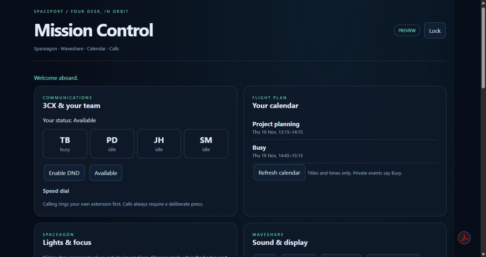
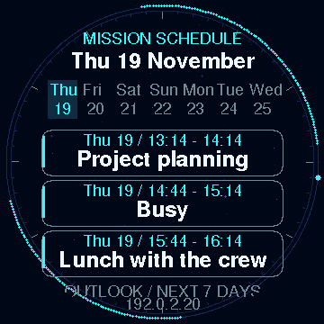

# Mission Control and calendar

Open `/admin` on your bridge hostname. Unlock with the separate `ADMIN_TOKEN`,
not a badge token, mailbox password or caller-review password. The browser keeps
it only in tab memory; Lock clears the token and displayed personal information.



The console offers team status, existing speed dials, DND, notifications,
Spaceagon LED brightness, themes, clocks and focus controls, plus Waveshare
volume, brightness, mute, alert acknowledgement and page selection.
Calling asks for confirmation and uses the existing own-extension call control.
Presence gating and call/notification priorities remain on the devices.

Device commands expire after 60 seconds. A newer command replaces an outstanding
command for the same device. The console reports **queued**, not delivered:
there is currently no device acknowledgement channel. Sliders show proposed
values, not live device readings. A restarted broker drops pending commands.
Settings received by a device are saved using its normal local settings store.

## Calendar

SOGo's authenticated HTTPS `.ics` endpoint is read every five minutes. Recurring
events and exceptions are expanded over the next seven days. The feed includes
only title, start/end times and the all-day flag. Private/confidential events
are displayed as **Busy**. Event descriptions, attendees and locations are not
sent to devices. Calendar content is fetched into memory and is not logged.
Calendar data older than 15 minutes is hidden as unavailable. Away mode hides
the calendar on Waveshare.



Configure `CALENDAR_CONFIG_FILE=/data/calendar.json`. Provision that private file:

```json
{"url":"https://mail.example.com/SOGo/dav/user@example.com/Calendar/personal.ics","username":"user@example.com","password":"ENTER_LOCALLY"}
```

Alternatively `CALENDAR_CONFIG_JSON` initializes the file only when it does not
already exist. Keep `/data` on a persistent volume writable by UID 10001. This
file contains the mailbox credential: use restricted server access and a
dedicated calendar account with read-only sharing where practical. No Microsoft
tenant registration is needed. HTTPS certificates are verified and redirects
are refused so calendar credentials cannot be forwarded to another location.

The existing `/lookup` number book keeps its separate review capability. Caller
lookup API keys and calendar credentials are never included in admin responses.

## Matrix focus sand

Spaceagon Settings includes **Sand Fall** (Down, Left, Up, Right) and **Focus
Light**. Both persist across app restarts and are also controllable from Mission
Control. Orientation changes only the sand animation; caller text stays upright
according to the existing matrix driver. Settled sand uses 80% of the selected
focus brightness; the falling head uses 100%, with a fading trail. The default
focus brightness is 35%, independent of incoming-call matrix brightness.

## Routing and access

Expose only `/admin`, `/admin/`, `/admin/api/state` and the POST endpoints
`device`, `notify`, `call`, `dnd`, `calendar_refresh` beneath `/admin/api/`.
Keep existing state/control/notification/review routes. Do not expose all bridge
paths or device web interfaces. Every admin API request requires its independent
bearer capability plus `X-Spaceport-Admin: 1`; badges cannot administer the broker.

Validation: 806 Python checks passed; Waveshare firmware built and application-
only flashed, preserving NVS. Spaceagon source files were hash-verified on USB,
with private configuration and CA unchanged. Screenshots above use synthetic
events; they are host/browser previews, not photographs of either display.
