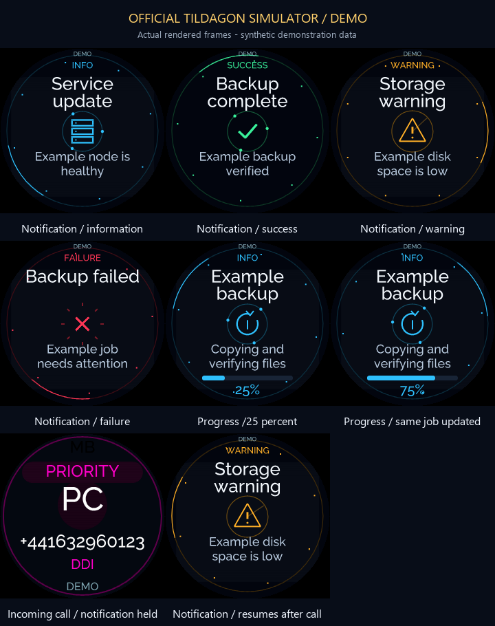
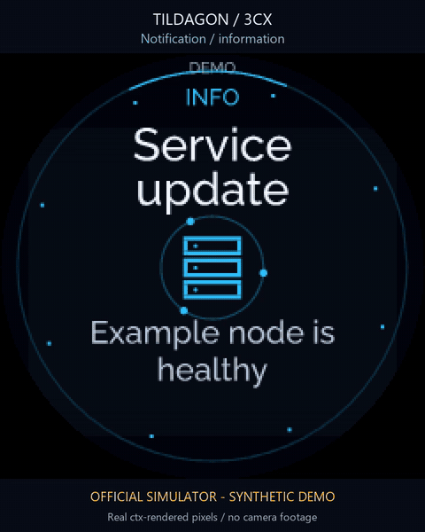

# Rich notifications

The bridge accepts Apprise's standard JSON webhook and a richer display-only
format at `POST /v1/notify`. The badge receives notifications through its existing
authenticated `/v1/state` connection. The queue is independent of 3CX polling,
presence and call controls; notification-provider failures do not change PBX
health. This feature does not make calls, execute actions or fetch remote images.

## Configure the bridge

Set a new private `NOTIFY_TOKEN`, with at least 24 printable ASCII characters and
no whitespace. A random 64-character hexadecimal token is suitable. It must be
different from `BRIDGE_TOKEN` and `BRIDGE_CONTROL_TOKEN`. Notification senders get
only this token; it cannot read call data or use call controls. Keep it out of
repositories, screenshots and public URLs.

For an external webhook, permit only `POST /v1/notify` through the existing HTTPS
proxy path rule. Authentication still happens at the bridge. Without a configured
token, this endpoint returns 503. Wrong bearer credentials return 401; malformed
payloads return 400; requests over 4KiB return 413. Browser-origin requests are
rejected. Responses contain only status and notification ID, never message text.

## Apprise

Apprise's [Custom JSON service](https://appriseit.com/services/json/) uses `jsons://`
for HTTPS and supports custom request headers through `+Header=value` URL options.
Configure this notification URL privately, replacing the placeholder token:

```text
jsons://badge-bridge.example.com/v1/notify?+Authorization=Bearer%20YOUR_NOTIFY_TOKEN
```

URL-encode the header value if the token contains punctuation. Keep Apprise's
body format as plain text. Its normal payload is accepted directly:

```json
{
  "version": "1.0",
  "title": "Example backup",
  "message": "Completed successfully",
  "type": "success"
}
```

The supported types are `info`, `success`, `warning` and `failure`. Optional string
fields can use Apprise's documented payload additions, for example
`&:style=toast&:icon=server`. Use the rich JSON endpoint below for numeric progress,
priority and TTL values; those fields must be JSON numbers rather than strings.
Current Apprise also sends `attachments: []` when none are supplied; this empty
compatibility field is accepted. Nonempty attachments are rejected.

## Urgent alerts

Set numeric `priority: 5` for an urgent alert. It stays on the LCD beyond the
normal ten-second popup, until dismissed or its sender-selected TTL expires.
Only a live priority call on your own extension interrupts it; the alert returns
when that call finishes. Normal calls and team ringing do not replace the card.
Call LEDs and the matrix retain their call indications. Manual settings and
telephone action confirmations remain accessible. Press C or joystick centre to
dismiss; lower-priority notifications retain the normal timeout and call rules.
While an urgent card is visible, all twelve badge LEDs hold solid red at255,
overriding the saved ring level. The EEH logo breathes in red from64 to255 and
back over four seconds (0.25Hz), without switching off or using the partner
heartbeat pattern. Saved brightness levels return on dismissal/expiry; priority
calls retain precedence. Showcase mode retains its existing brightness caps.

The slow continuous envelope reduces abrupt modulation but is not a guarantee
of safety for photosensitive people. Red modulation, viewing conditions and
individual sensitivity matter. The underlying hardware PWM was not measured.
See [Epilepsy Action guidance](https://www.epilepsy.org.uk/info/seizure-triggers/photosensitive-epilepsy).

Use `ttl_seconds: 86400` for up to 24 hours. Expiry and dismissal are never reset
by updates with the same ID.

## Rich JSON

Send `Content-Type: application/json` and `Authorization: Bearer YOUR_NOTIFY_TOKEN`:

```json
{
  "id": "example-backup-job-001",
  "title": "Example backup",
  "body": "Copying files",
  "type": "info",
  "priority": 3,
  "style": "progress",
  "icon": "backup",
  "progress": 42,
  "ttl_seconds": 1800
}
```

Update a running job using the same ID:

```json
{"id":"example-backup-job-001","progress":73,"body":"Verifying files"}
```

| Field | Accepted values |
| --- | --- |
| `id` | Optional 1–64 ASCII letters/digits or `_ . : -`; generated when absent |
| `title`, `body` | Plain UTF8 text; safely clipped to 80/320 **bytes**, without splitting a character |
| `type` | `info`, `success`, `warning`, `failure`; default `info` |
| `priority` | Integer 1–5; default 3 |
| `style` | `card`, `toast`, `progress`, `badge`; defaults to `progress` when a new item has progress, otherwise `card` |
| `icon` | `info`, `check`, `warning`, `error`, `bell`, `server`, `download`, `upload`, `backup`, `lock`, `phone`, `message`, `heart`, `cloud` |
| `progress` | Number 0–100 or `null` |
| `ttl_seconds` | Integer 1–86400; default 300; `ttl` is an input alias |

The maximum queue length is 16, newest first. Evicting or expiring an item retains
its ID in a bounded in-memory history. Exact duplicate messages without IDs also
deduplicate while active. An explicit ID update changes content/progress while
preserving its **original arrival and earliest expiry**. Updates cannot keep an
alert alive indefinitely. Use a new ID for a genuinely new alert, completion
message or intentional renewal. Broker history and the queue reset on restart.

Only the listed display fields are accepted. `actions`, links, remote icon URLs,
nonempty attachments and arbitrary fields are rejected by this endpoint. The badge's
snapshot contains `age_seconds`, `ttl_seconds` and server `received` time, so
repeated polling does not renew or replay a dismissed alert.

## Optional ntfy subscription

To receive an existing topic instead of posting directly, set these private bridge
environment values:

```text
NTFY_URL=https://ntfy.example.com
NTFY_TOPIC=your-private-topic
NTFY_TOKEN=YOUR_NTFY_READ_TOKEN
```

The URL is an HTTPS base URL, optionally with a reverse-proxy path, without query
parameters or embedded credentials. The topic is a single 1–64-character ASCII
letters/digits/underscore/hyphen name. Use a read-only token scoped to that topic
when the server supports it. The token is optional for a server/topic that does
not require authentication. Invalid optional subscription configuration disables
that subscriber while call monitoring continues.

The subscriber uses ntfy's documented
[newline-delimited JSON stream](https://docs.ntfy.sh/subscribe/api/) at
`/<topic>/json`. It sends the token in an `Authorization: Bearer` header, using
ntfy's [access-token authentication](https://docs.ntfy.sh/publish/#access-tokens).
TLS verification is enabled and redirects are refused. After a connection drops,
it resumes with the last message ID and reconnects with 1–60-second backoff.
Initial startup listens for new events rather than replaying the whole cache.

Titles, messages and priorities are mapped into the bounded queue. Recognised
tags select local type/icon glyphs: error/failure, warning, success/check, and
backup/server/download/upload/lock/phone/heart/cloud. Sequence IDs update an
existing item; delete/clear events affect only imported ntfy notifications.
Imported messages use at most a 300-second lifetime from their original publish
time. Remote click actions, icon URLs and attachments are ignored and never
downloaded. Oversized or malformed stream lines are skipped. This subscription
does not publish any ntfy message.

## Validation and privacy

The tests use fake services and a local HTTP test server. They cover bearer-role
separation, request limits, UTF8 clipping, expiry/update/deduplication, bounded
queues/history, malformed streams, cursor reconnects and provider failure
isolation. Notification content and credentials are not logged or written to
disk. Sending to an external ntfy provider remains a separate sender-side choice;
this bridge subscribes only to the server/topic explicitly configured above.

## Badge controls

New alerts receive a brief automatic presentation. Open the retained inbox with
**N** on an attached keyboard. Arrow keys browse, **Enter** dismisses the current
item, and **Space/Escape** returns. Physical **B/E** browse, **C** dismisses and
**F** returns. Dismissal is local and does not execute a sender-supplied action.

On Spaceagon, the joystick directions browse and its centre press dismisses an
open notification. A deliberate rotation around the capacitive touch ring also
browses. These inputs only navigate the UI; they never confirm a phone action.
Calls and other phone attention take precedence over notification cards.

## Screenshots and animation





[Watch the 32-second MP4](gallery/notifications.mp4). The tour shows all four types,
a same-ID progress update from 25% to 75%, a priority call preempting the card, and
the waiting alert appearing after the call ends.

These are actual 0.9 badge-app frames rendered by the official SDL/ctx simulator,
with invented example messages and reserved telephone numbers. No real webhook,
notification delivery or call was made. The recordings preserve monotonic capture
timing, without motion interpolation or physical-camera footage. Native 240px
stills are paired with full-window captures in `docs/gallery/`.

The [portable simulator](../simulator/README.md) can reproduce them from this
checkout, with empty credentials and a generated DEMO configuration:

```powershell
./Launch-Simulator.ps1 -Notification warning -Screenshot -OutputPath ./warning.png
./Launch-Simulator.ps1 -Record ./notifications.mp4 -Showcase notifications -Seconds 32 -GalleryStills -DemoDate 2026-12-12
```

`-Notification` accepts `info`, `success`, `warning`, `failure` or `progress` and
opens the production inbox after the firmware's boot overlay. The tour changes
synthetic input snapshots; the app's rendering and call-preemption rules are the
same ones used on the badge.

## Matrix text

Version0.16 scrolls the selected notification's title, progress and body on the
Lite Loop, using the native ASCII renderer. Normal call activity takes priority;
urgent messages yield only to priority own calls. Messages remain eligible
until their original TTL or local dismissal, even after the LCD popup ends.
See [matrix behaviour and the animation](MATRIX.md#notification-scrolling-version016).
