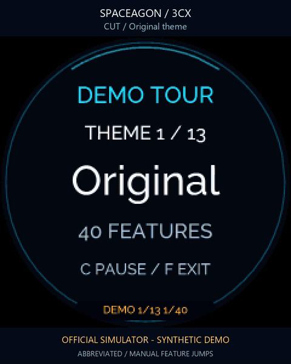

# On-device showcase



[Watch the short video](gallery/showcase.mp4) · [Screenshot contact sheet](gallery/showcase-contact-sheet.png)

This preview makes explicit manual jumps between representative scenes. The
badge's normal tour follows every stage in order and loops without those cuts.

The showcase runs the badge's real renderers with invented data. It walks through
the built-in themes, all nine clocks, weather and rain conditions, lunar/meteor
pages, Advent, team status, caller-ID variants, notifications, presence and
settings. Every page is labelled **DEMO**. Partner names, example numbers,
locations and occasion dates come from isolated fixtures, not your configuration.

## Start and navigate

Without a keyboard, hold **C** to open settings, select the final **DEMO** row with
**A/D**, then press **C** to play. With an attached keyboard, press **D**, or open
settings with **S**, choose **DEMO**, then press **Enter**. This works inside the
existing app; no restart, bridge change or network connection is needed for the
synthetic scenes.

| Action | Badge buttons | Keyboard |
| --- | --- | --- |
| Start showcase | Without keyboard: hold C for settings; select DEMO; press C | D, or Settings → DEMO → Enter |
| Next / previous scene | B / E | Right / Left |
| Next / previous theme | A / D | Up / Down |
| Pause / resume automatic advance | C | Space or Enter |
| Leave showcase | F | Escape or D |

Physical **D** changes the theme while showcasing; keyboard **D** leaves it.
Leaving restores your previous view and resumes live monitoring while keeping
the app running. If you entered from settings, that settings view returns.
Buttons held across
that transition must be released before their normal phone-control mapping can
act again. On Spaceagon, joystick left/right steps scenes, up/down changes theme
and centre pauses/resumes. Touch-ring rotation steps scenes. These gestures never
confirm a telephone action.

The sequence groups the demonstrations by theme. Manual scene/theme changes do
not save a new appearance preference. The settings demonstration scrolls through
all five rows without changing or saving their values. The photographic theme and Atelier dial
use the same verified local assets and fallback behavior as normal operation.
Optional EEH and Liteloop displays use their existing drivers when present.

The thirteen built-in themes have **521 stages**: 40 per theme, plus Christmas
Advent. At five seconds per stage, an uninterrupted full loop takes **43 minutes
25 seconds**. It loops continuously; pause, skip a scene or jump to another theme
at any point.

## Separation from live monitoring

While showcasing, the badge displays synthetic data and **pauses live bridge
polling and phone commands**. Real incoming calls and external notifications are
not monitored during the tour; leave it to resume the desk monitor. The bridge
itself continues operating normally.

Opening the showcase clears an unsent phone intent. If a real call/DND request is
already being sent, entry is refused until that request finishes. Opening a
showcase cannot undo a request that has already been sent.

Theme, clock, brightness, private occasion dates and the original live state are
kept separate and restored on exit. The tour does not save synthetic preferences
or rewrite the private configuration. Restoring an old snapshot does not refresh
its age; the normal stale-data display applies until a new bridge read succeeds.
Late results from a read started before the mode change cannot replace the
showcase or become a fresh snapshot after it closes.

The showcase makes no calls, changes no PBX presence, submits no notification and
performs no contact or weather lookup. Its simulated calls and DND examples are
display-only. It needs no additional PBX permission or credential.

## Development checks

The portable official simulator can run this same production mode:

```powershell
./Launch-Simulator.ps1 -FeatureDemo
```

In that launcher, **Shift+D** sends the keyboard shortcut; plain PC **A–F** remain
the simulator's physical badge buttons. This lets physical **D** change theme
without being confused with the keyboard exit command.

`tests/test_showcase_integration.py` exercises the real app with fake hardware and
network work. It checks pending/in-flight command boundaries, delayed fetch
success and failure, preference isolation, button release gating and returning to
the original live controller. The pure scene-generator tests cover the sequence
and its synthetic fixtures. Native-device results retain their own version scope
in [validation](VALIDATION.md).
