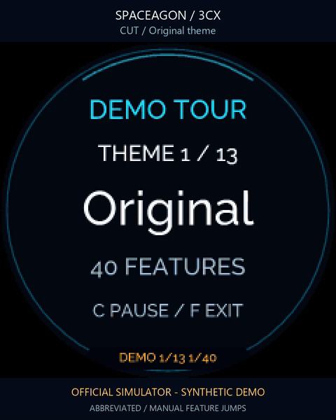
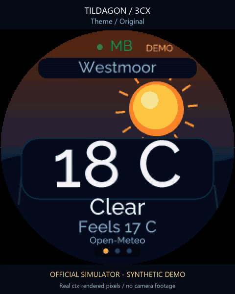
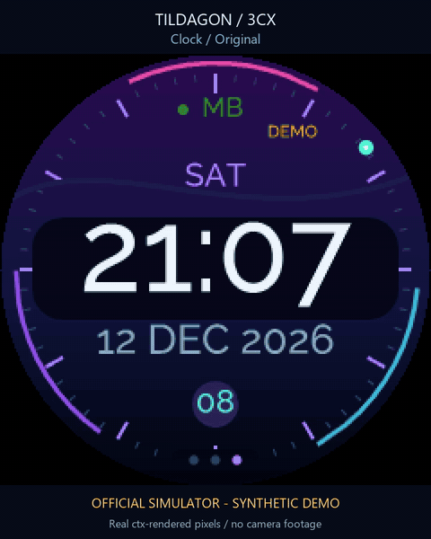
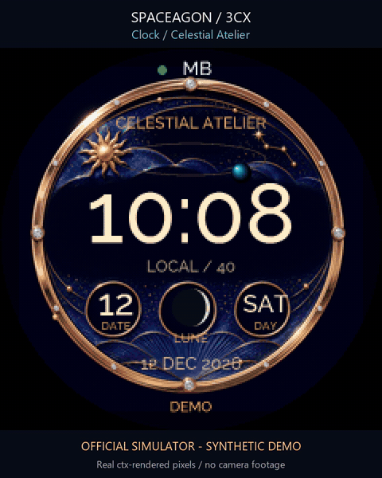
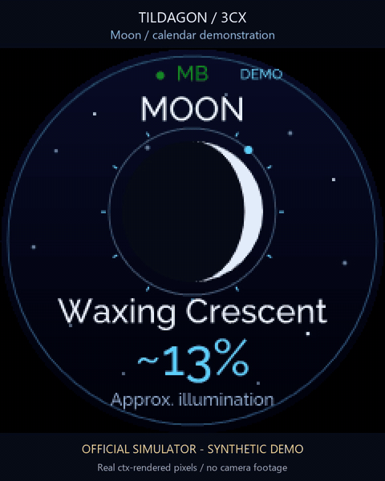
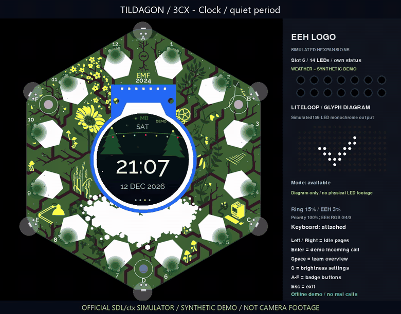
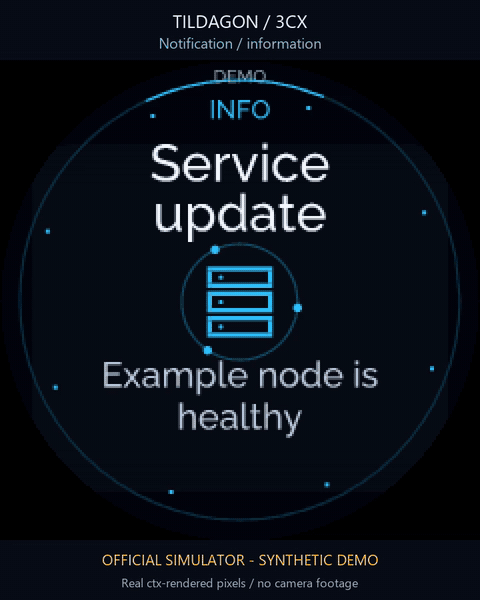

# Simulator gallery

These are actual frames from the official Tildagon SDL/ctx simulator running
the badge app. Every call and weather value is synthetic. **Westmoor is an
invented location**, **Partner is a placeholder name**, and the caller number
`+44 1632 960123` is a reserved example. The December dates demonstrate the
calendar and Advent pages; no personal birthdays, anniversary dates or ages
are supplied. The isolated simulator config contains no PBX address or token.



[56-second feature preview](showcase.mp4) · [Feature contact sheet](showcase-contact-sheet.png) ·
[Validation and capture scope](../VALIDATION.md) · [On-device showcase controls](../SHOWCASE.md).

This preview starts the app's production showcase and selects sixteen real
stages through its own navigation method. **CUT** labels and the video footer
identify these representative jumps. The film is abbreviated; it does not show
the complete cycle or speed up its animations. On the badge, the normal mode
plays every feature in each theme before moving to the next: 521 five-second
stages across thirteen themes, or **43 minutes 25 seconds** per full cycle.
Calls, presence changes, notifications and occasion dates in this mode are
fictional, and its telephone controls remain disabled.



[Theme video](themes.mp4) · [Theme contact sheet](themes-contact-sheet.png) ·
[All theme stills](themes-gallery.png)



[Clock video](clocks.mp4) · [Clock contact sheet](clocks-contact-sheet.png) ·
[Corpus-inspired loop](clock-corpus.mp4) · [Corpus animation](clock-corpus.gif)



[Celestial clock video](clocks-atelier.mp4) · [Celestial clock contact sheet](clocks-atelier-contact-sheet.png) ·
[Celestial Atelier](clock-haute_celestial.png) · [Neon Orrery](clock-neon_orrery.png).
This separate tour adds the two celestial faces to the original seven-clock
collection. Their local time and moon phase use the app's calculations; planetary
positions and mechanical motion are decorative. Dial artwork is original and
contains no brand logos.



[Sky video](sky.mp4) · [Sky stills](sky-gallery.png)



[Call video](partner-call.mp4) · [Call still](partner-call.png)



[Notification video](notifications.mp4) · [Notification contact sheet](notifications-contact-sheet.png) ·
[Configuration and controls](../NOTIFICATIONS.md). This synthetic tour includes
information/success/warning/failure, job progress and call preemption.

The videos retain real monotonic capture timing. They contain no motion
interpolation; encoding may repeat captured frames to produce a compatible
H.264 stream. Capture speed varies with the computer and is **not a physical
badge frame-rate measurement**. GIFs are looped previews. The `-lcd.png` files
are the native 240 × 240 LCD pixels; paired PNGs show the whole simulator.

There is **no camera footage**. The upstream simulator uses its own board
artwork. The EEH panel is a schematic, and the Liteloop panel is a labelled
156-LED monochrome diagram driven by the real app adapter through an in-memory
I2C sink. Its dots illustrate the glyph and heartbeat; they do not establish
the physical LED colour, PCB arrangement, brightness or hardware timing.

## Reproduce the captures

From the project folder, prepare the pinned simulator runtime once:

```powershell
py -3.10 tools/prepare_simulator.py
```

Then run the public launcher. The `GalleryStills` switch exports matching
full-window and native LCD stills near each scene's midpoint. A Partner still
may use another actual heartbeat phase.

```powershell
./Launch-Simulator.ps1 -Record ./docs/gallery/themes.mp4 -Showcase themes -Seconds 28 -DemoDate 2026-12-12 -GalleryStills
./Launch-Simulator.ps1 -Record ./docs/gallery/clocks.mp4 -Showcase clocks -Seconds 18 -DemoDate 2026-12-12 -GalleryStills
./Launch-Simulator.ps1 -Page clock -Showcase atelier -Record ./docs/gallery/clocks-atelier.mp4 -Seconds 28 -GalleryStills -DemoDate 2026-12-12 -DemoTime 10:08:30
./Launch-Simulator.ps1 -Page clock -Showcase rail -Record ./docs/gallery/clocks-rail.mp4 -Seconds 28 -GalleryStills -MatrixDemo
./Launch-Simulator.ps1 -Record ./docs/gallery/clock-corpus.mp4 -Showcase idle -Page clock -ClockStyle corpus -WeatherKind night -Seconds 8 -DemoDate 2026-12-12 -GalleryStills
./Launch-Simulator.ps1 -Record ./docs/gallery/sky.mp4 -Showcase sky -Seconds 12 -DemoDate 2026-12-12 -GalleryStills
./Launch-Simulator.ps1 -Record ./docs/gallery/partner-call.mp4 -Showcase calls -Page clock -Theme christmas -RecordView window -Seconds 12 -DemoDate 2026-12-12 -PartnerDemo -MatrixDemo -GalleryStills
./Launch-Simulator.ps1 -FeatureDemo -Record ./docs/gallery/showcase.mp4 -Seconds 56 -GalleryStills -MatrixDemo
```

A single screenshot or an interactive preview can use any theme and clock:

```powershell
./Launch-Simulator.ps1 -Screenshot -Page weather -Theme cyberpunk -DemoDate 2026-12-12 -OutputPath ./theme-example.png
./Launch-Simulator.ps1 -Page clock -Theme ocean -ClockStyle corpus -MatrixDemo
./Launch-Simulator.ps1 -FeatureDemo
```

For direct Python use, see the [portable simulator instructions](../../simulator/README.md).

## Railway clocks, version 0.12

[Mondaine](clock-mondaine.png) and [Great British Railways](clock-great_british_railways.png)
have paired native 240×240 LCD crops (`-lcd.png`). The
[28-second film](clocks-rail.mp4), [full GIF](clocks-rail.gif) and
[contact sheet](clocks-rail-contact-sheet.png) contain 421 actual captures over
28.004306 seconds. Mondaine's supplied synthetic local time crosses 10:08:58,
10:08:59 and 10:09:00: the actual dial pixels match during the two-second dwell,
then the minute hand advances. GBR has a labelled synthetic time cut to 10:09:22
and shows its opposed red arrows meeting at 10:09:30. All 28 runtime and asset hashes match this version's
capture source. These are simulator recordings, not physical badge footage.

No live PBX action, contact lookup or weather request is made by these fixtures.
In the interactive simulator, **Shift+D** emits the expansion keyboard's D key
to start or stop the production showcase; unshifted A–F retain their physical
badge-button mappings. The standalone `-FeatureDemo` preview runs continuously
without the recording's manual feature jumps.

## Waving bunny, version 0.13

The [bunny film](bunny-call.mp4), [GIF](bunny-call.gif) and
[poster](bunny-call-poster.png) use synthetic Partner/Example labels, with no
phone number or caller initials. The native vector rabbit waves and blinks.
This is an official-simulator recording: 110 actual frames over 8.031637 seconds,
not camera footage or native FPS evidence. Older galleries predate removal of
the owner initials/status strip.
