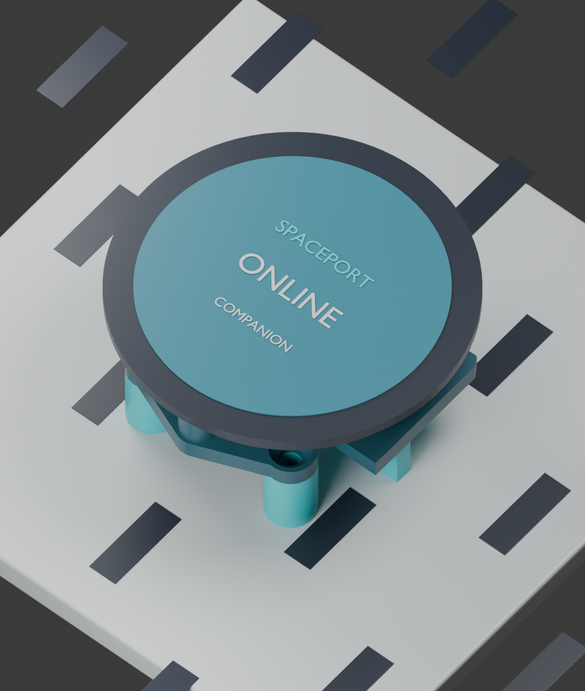
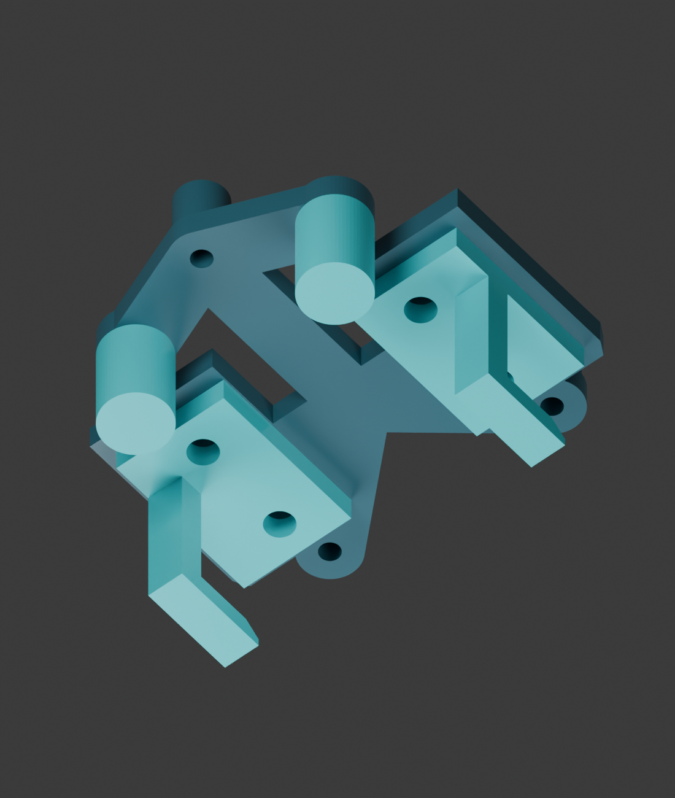

# Compact Spaceport Skådis mount

The display is the entire visible footprint: **55 mm diameter**. The carrier, hooks and two stabilising feet hide behind it. There is no speaker cradle, top bridge or visible fixing tab. Nominal screen-front distance from the pegboard is approximately 26 mm, leaving access for cables and rear components.

Mount the speaker behind the pegboard and feed its cable through a nearby existing slot or suitable hole before connecting it. Leave a little slack and protect the cable from sharp edges. Keep the connector and wiring clear of the mounting screws. The open carrier does not obstruct the USB socket or volume knob.

Print `carrier.stl` once, `hook_left.stl` once, `hook_right.stl` once and `foot.stl` twice. Files are oriented for printing, with the hooks on their sides for strength. Suggested PETG, 0.2 mm layers, four walls and 30% infill; supports should not be necessary. Print the two small hooks first to check the pegboard fit. The left and right hooks are different: do not substitute two copies of one.

## Print and assemble

Print one **carrier.stl**, one **hook_left.stl**, one **hook_right.stl**, and two **foot.stl**. The hook files are handed: print both, rather than two copies of one. Each STL is already oriented flat for printing. Print a hook first to check the pegboard fit. Suggested PETG, 0.2 mm layers, four walls and 30% infill; supports should not be necessary.

1. Bolt the hook pads behind the carrier using four M3×10 countersunk screws and M3 nuts. Screw heads must sit flush on the device side; nuts go behind the hook pads, towards the pegboard. The hook necks are 40 mm apart and their lips point upwards behind the pegboard. The pads point inwards towards the centre.
2. Attach the two 11 mm rear feet using two M3×8 countersunk screws into their printed pilot holes. Do not overtighten.
3. Fix the device to the three 9 mm front mounting posts using suitable M2 screws and washers. Select length to give only 1.5–2 mm thread engagement; M2×12 with approximately 1 mm washers is a starting point. Check the actual threaded depth and component clearance on your device before tightening. Never clamp the glass.
4. Route the speaker cable behind the pegboard, connect it and hang both hooks on the same slot row. Slide down until seated. Check stability, screw clearance, cable slack and access to the volume knob.

Editable source: `spaceport-skadis-compact.scad`. The mounting centres from the front are (+14.90,+15.73), (−14.10,+15.73), (0,−21.27) mm, based on the [official Waveshare mechanical drawing](https://files.waveshare.com/wiki/ESP32-S3-Touch-LCD-1.85/ESP32-S3-Touch-LCD-1.85.rar). Skådis nominal 5×15 mm slots and 40 mm same-row pitch are [community-measured dimensions](https://github.com/soloh4cker/skadis_pegboard_studio).

**Fit-check prototype:** digitally checked meshes and footprint, not physically printed or load tested. Check your board and screw depths before hanging the electronics. The preview uses a simplified device envelope. This replaces the larger mount with a speaker tray.
