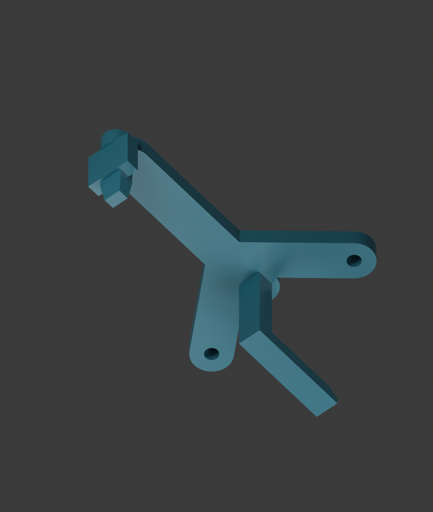

# Simple one-piece Spaceport Skådis holder

**One printed part. One top hook. One lower locating peg. Only the three screen screws.** No separate hooks, nuts, feet or speaker tray. The holder stays inside the 55 mm screen footprint. Screen front sits approximately 16 mm from the pegboard.

Print `spaceport-skadis-simple.stl` once. It is oriented on its side for hook strength. Suggested PETG, 0.2 mm layers, four walls, 30% infill, an 8 mm brim and supports everywhere. Remove supports carefully from the hook throat and the three 2.4 mm screw holes. Do not print a separate peg or hook.

Fix the flat 3 mm carrier directly to the screen’s existing raised mounting bosses using the three M2 holes. No extra printed standoffs are needed. Choose screws for the 3 mm plate, any washer, and only 1.5–2 mm thread engagement. M2×5 with approximately 0.5 mm washers is a starting point; check the actual threaded depth before tightening. The existing bosses provide component clearance.

Tilt the holder to feed the upper hook through a slot, then lower it into place while guiding the stabilising peg into the next hole **in the same column, 40 mm below**. Skådis rows are staggered: skip the offset intermediate row. The retaining lip reaches above the upper slot; the short lower peg prevents sideways rotation. Check secure seating before leaving the device hanging.

Place the speaker behind the pegboard, route its cable through a spare slot or suitable protected hole, and leave slack at the connector. The rear of the carrier remains open for components and controls.

Editable source: `spaceport-skadis-simple.scad`. Device mounting centres from the FRONT: (+14.90,+15.73), (−14.10,+15.73), (0,−21.27) mm from the [Waveshare mechanical drawing](https://files.waveshare.com/wiki/ESP32-S3-Touch-LCD-1.85/ESP32-S3-Touch-LCD-1.85.rar). Pegboard assumptions: 5×15 mm slots, 40 mm same-column pitch, 5 mm thickness. Source: [Skådis dimensional reference](https://github.com/soloh4cker/skadis_pegboard_studio).

**Prototype:** digitally checked, not physically printed, fitted or load tested. Check pegboard tolerances, insertion clearance, component clearance and screw length on the real hardware. Hook width and board dimensions are editable in the source. This supersedes the earlier multipart carriers.
