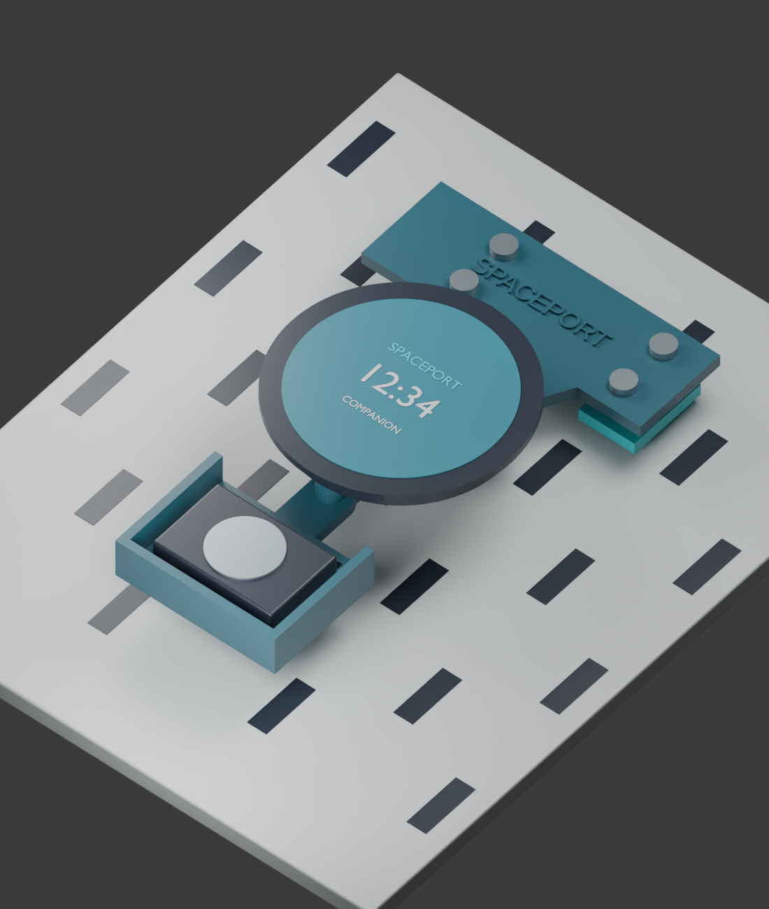

# Spaceport Skådis carrier

Fit-check prototype for the Waveshare ESP32-S3 (Touch) LCD 1.85 and wired speaker. The open carrier uses the three M2 mounting points and leaves the USB socket, SD card and volume knob accessible. Never clamp the glass.

Print `carrier.stl` once, `hook.stl` twice and `bumper.stl` once. Files are oriented for printing. **Print one hook first to check your pegboard fit.** Suggested PETG, 0.2 mm layers, four walls, 30% infill, no supports. Editable dimensions are in `spaceport-skadis.scad`.

Hardware: four M3×10 bolts with nuts and washers for the hook pads; three suitable M2 device screws with washers; one M3×8 countersunk screw for the bumper; two small cable ties for the speaker. Select M2 screw length for only 1.5–2 mm thread engagement after the 9 mm carrier/post stack and washers. Nominal M2×12 with a 1 mm washer is a starting point. Actual threaded depth must be checked before tightening.

Bolt the hooks behind the top bridge, nuts at the front. Attach the bumper behind the speaker tray with the countersunk screw. Attach the board to the three front posts, checking clearance under every component. Secure the speaker over its frame edges, avoiding the diaphragm. Tray clearance is 36×28 mm: measure your actual speaker surround first. Hang both hooks on one row and slide down to engage; check seating and cable strain relief.

The official Waveshare drawing specifies a 55 mm display envelope and these M2 centres from the FRONT: (+14.90,+15.73), (−14.10,+15.73), (0,−21.27) mm. Posts provide nominal 2 mm clearance behind components. Source: [Waveshare mechanical drawing](https://files.waveshare.com/wiki/ESP32-S3-Touch-LCD-1.85/ESP32-S3-Touch-LCD-1.85.rar).

Skådis uses nominal 5×15 mm slots, 40 mm same-row pitch and approximately 5 mm board thickness. These are community-measured dimensions; adjust the hook width after the fit test. The design has been checked digitally, **not physically printed or load tested**. The assembly preview uses a simplified device envelope.

Slot reference: [Skådis Pegboard Studio's dimensional description](https://github.com/soloh4cker/skadis_pegboard_studio). Geometry here is original and does not incorporate that project's code.
